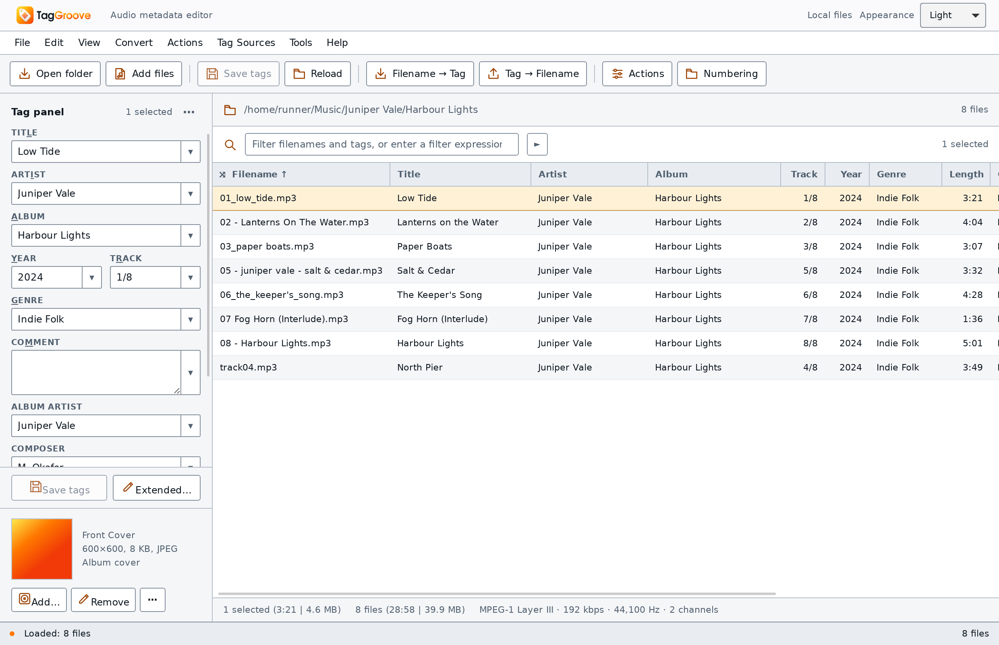
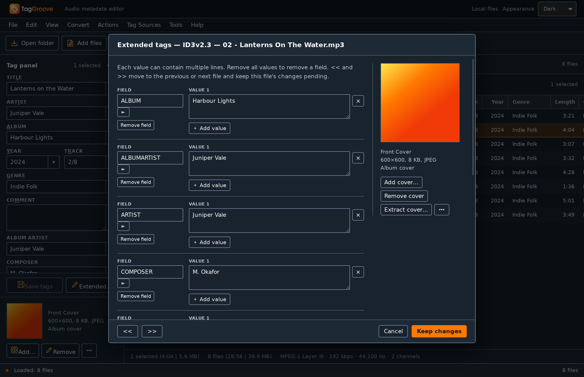
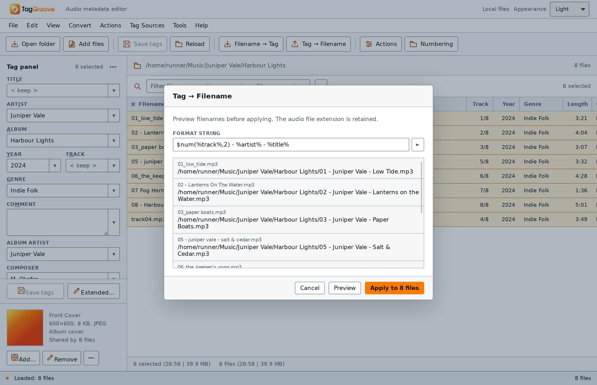

<p align="center">
  <picture>
    <source media="(prefers-color-scheme: dark)" srcset="assets/brand/TagGroove-Brand-Kit/03-banners/taggroove-readme-dark-1600x480.svg">
    
  </picture>
</p>

<p align="center">
  <a href="https://github.com/johnneerdael/TagGroove/releases/latest"></a>
  <a href="https://taggroove.neerdael.nl/"></a>
  
  <a href="COPYING"></a>
</p>

TagGroove is a free, open source music tag editor for Windows, macOS and Linux. Fix an album's tags, find the right artwork, rename a folder of files, or turn a cleanup you do every week into a saved action group.

Open a folder and get to work. You can edit files directly, look up missing details from music catalogs, and choose exactly which fields to keep. The everyday tagging tools work offline; online sources are there when you need them.

<p align="center">
  <a href="https://github.com/johnneerdael/TagGroove/releases/latest"><b>Download</b></a> &nbsp;·&nbsp;
  <a href="https://taggroove.neerdael.nl/getting-started/"><b>Get started</b></a> &nbsp;·&nbsp;
  <a href="https://taggroove.neerdael.nl/"><b>User guide</b></a> &nbsp;·&nbsp;
  <a href="https://github.com/johnneerdael/TagGroove/issues"><b>Report an issue</b></a>
</p>

<p align="center">
  <picture>
    <source media="(prefers-color-scheme: dark)" srcset="docs/user-guide/assets/screens/main-window-dark.png">
    
  </picture>
</p>

## What you can do

| Task | In TagGroove |
| --- | --- |
| Edit a whole album | Change shared fields across a selection, edit individual cells, or open extended tags for custom fields and multiple values. |
| Fill in missing metadata | Search MusicBrainz, Discogs, Beatport, Traxsource, iTunes or Deezer. Review the result and match its tracks to your files before saving. |
| Find the right mix | Use built-in Beatport and Traxsource track or release lookups, keep mix/version details, and open a matched track's full release. |
| Compare catalog results | For one file, compare Discogs, Beatport and Traxsource side by side. Choose a source for each field while keeping the rest of your tags. |
| Sort out artwork | Add, replace, extract and resize embedded covers, or look up artwork without changing text tags. |
| Fix filenames and folders | Build names from tags, read tags from existing filenames, and preview conversions before applying them. |
| Stop repeating the same cleanup | Save ordered action groups for replacements, regular expressions, case changes, field formatting and more. |
| Number and export | Number tracks across albums and discs, generate playlists, and export CSV or HTML catalogs through customizable templates. |
| Make the editor fit | Choose light or dark appearance, customize columns and the tag panel, and filter the file list by tags or file properties. |

Supported formats include MP3, FLAC, M4A/MP4, AAC, ALAC, WAV, AIFF, Ogg Vorbis, Opus, WMA, WavPack, APE, DSF and DFF. Tag storage and artwork support vary by format; the [format reference](https://taggroove.neerdael.nl/reference/file-formats/) has the full list and limits.

## A closer look

<table>
  <tr>
    <td width="50%"><br><sub><b>The details are editable.</b> Work with custom fields, multiple values and artwork in one place.</sub></td>
    <td width="50%"><br><sub><b>See the names first.</b> Preview what a format string will do before renaming files.</sub></td>
  </tr>
</table>

For example, this filename format:

```text
$num(%track%,2) - %artist% - %title%
```

turns `01_low_tide.mp3` into `01 - Juniper Vale - Low Tide.mp3` using the file's tags. Save the format for the next album, or build an action group when the job needs several steps. The guide includes [practical recipes](https://taggroove.neerdael.nl/cookbook/) for the usual library chores.

## Built-in music sources

Beatport and Traxsource are built in, with searches for individual tracks and complete releases. You can keep the full mix name, check the track's actual release position, and fetch the rest of the release from a track match.

Discogs supports release searches by artist and album, free text, barcode or catalog number, plus direct release links. Artist-and-title search helps when you have a single track: choose the edition, then pick the exact track from its tracklist.

When catalogs disagree, **Tag Sources → Compare metadata…** puts each provider’s values next to your current tags. Take the title from one source and the label from another, or leave a field alone. Nothing is selected for replacement until you choose it. Artwork is handled separately. The guide walks through it in [Compare metadata from several sources](https://taggroove.neerdael.nl/tag-sources/compare/).

MusicBrainz, iTunes, Deezer, LRCLIB lyrics and AcoustID fingerprint lookup are available too. Some services need credentials, and Traxsource may need an optional challenge solver. See [tag sources](https://taggroove.neerdael.nl/tag-sources/) for setup, network use and provider limits.

## Bring your Mp3tag setup

Already have action groups and naming rules you like? **File → Import Mp3tag setup…** reads an Mp3tag configuration folder or backup ZIP and previews what can come across.

Import supported action groups, export templates, column and tag-panel layouts, custom field values and preferences. Choose what to keep or replace; unsupported settings are reported. The import leaves your original Mp3tag setup unchanged and does not run actions or edit music files.

TagGroove can also save and restore its own configuration backups. Compatibility with Mp3tag is still growing; the [migration guide](https://taggroove.neerdael.nl/getting-started/coming-from-mp3tag/) explains what is supported and what needs review.

## How your files are handled

TagGroove's audio metadata writer stages changes in a copy and verifies that copy before replacing the file. Preservation tests check audio packet hashes, unknown fields and covers across supported formats. This is metadata editing; it does not transcode your music.

Tag-panel edits wait for **Save tags**. Actions, applied converters and source imports write when confirmed in their own dialogs. Eligible desktop operations have Undo/Redo history, but its availability depends on the operation and successful history storage. Keep backups of your music. Read [editing and saving](https://taggroove.neerdael.nl/getting-started/editing-and-saving/) and [Undo limits](https://taggroove.neerdael.nl/tagging/undo-history/) before a large batch.

Online lookups send search terms and identifiers to the chosen provider. AcoustID sends a locally computed fingerprint and duration. These lookups do not upload your audio files.

## Install

Choose your operating system and processor from the [latest release](https://github.com/johnneerdael/TagGroove/releases/latest). You do not need Rust or Node.js to use a downloaded build.

| System | Download | Notes |
| --- | --- | --- |
| Windows, x64 | `-windows-x64-setup.exe` | Desktop installer. Unsigned; Windows may show an unknown-publisher warning. |
| macOS, Apple silicon | `-macos-arm64.dmg` | Also available as an app archive. Check the release's signing and notarization notes. |
| macOS, Intel | `-macos-x64.dmg` | Separate Intel build; check the same release notes. |
| Linux, x64 or arm64 | `.AppImage`, `.deb` or `.rpm` | Unsigned. Built on Ubuntu 24.04; compatibility with older distributions is not established. |

Releases include `SHA256SUMS`, a release manifest and corresponding source. The [installation guide](https://taggroove.neerdael.nl/getting-started/install/) covers package selection and platform-specific steps.

Android arm64 APKs and iOS ARM64 simulator builds are also available as UI previews. Mobile document editing and save-back are still in progress. The iOS archive is for a simulator, not an iPhone or iPad installer.

## Why I'm building it

I'm a paying Mp3tag user on macOS. Preparing my music had me moving between four apps: Lexicon, Mp3tag, OneTagger and Mixed In Key. I started [CueRithm](https://github.com/johnneerdael/CueRithm) with the goal of replacing that four-app workflow for myself.

TagGroove focuses on the tagging side: a dedicated editor I can use across operating systems. Mp3tag shaped the familiar workflows, and the project has grown to include built-in Beatport and Traxsource support, expanded Discogs searches and field-by-field catalog comparison. Importing an existing Mp3tag setup still matters; so does making the next tagging job easier.

## Still in development

TagGroove is pre-1.0. It does not yet match every Mp3tag workflow or container variation. A separate floating tag-panel window, mobile action execution and further compatibility work remain on the [open-work list](docs/PARITY.md). The [qualification register](docs/research/remaining-gaps.md#qualification-of-implemented-scopes) records where implemented features still need reference or platform verification.

If something gets in the way of tagging your music, [open an issue](https://github.com/johnneerdael/TagGroove/issues). Include your TagGroove version, operating system, file format and the steps that caused the problem. A specific example of a job you could not finish is useful.

## Documentation

The [user guide](https://taggroove.neerdael.nl/) is organised by feature: [Tagging](https://taggroove.neerdael.nl/tagging/), [Tag sources](https://taggroove.neerdael.nl/tag-sources/), [Rename & convert](https://taggroove.neerdael.nl/converters/), [Actions](https://taggroove.neerdael.nl/actions/), [Scripting](https://taggroove.neerdael.nl/scripting/), [Export & playlists](https://taggroove.neerdael.nl/export/) and [Customize](https://taggroove.neerdael.nl/customize/). Good places to start:

- [Your first tagging session](https://taggroove.neerdael.nl/getting-started/first-tagging-session/)
- [Clean up a messy library](https://taggroove.neerdael.nl/actions/clean-a-messy-library/)
- [Build an action group](https://taggroove.neerdael.nl/actions/first-action-group/)
- [Format strings](https://taggroove.neerdael.nl/scripting/format-strings/) and [regular expressions](https://taggroove.neerdael.nl/scripting/regular-expressions/)

## Credits and license

Mp3tag by Florian Heidenreich is the reference for many of TagGroove's editing workflows. TagGroove is an independent implementation; the original Mp3tag executable, code and vendor assets are not included. The projects are not affiliated.

Beatport and Traxsource support builds on OneTagger-derived code adapted through CueRithm. Thanks to [OneTagger](https://github.com/Marekkon5/onetagger) and the other open source projects this app depends on. See [catalog source provenance](crates/catalog-sources/README.md) and [third-party notices](THIRD_PARTY_NOTICES.md).

The combined application is GPL-3.0-only ([COPYING](COPYING)). Independently authored MIT components retain their [MIT license](LICENSE); dependencies retain their own licenses.

## For developers

TagGroove uses Tauri 2, a TypeScript interface and a Rust tagging engine. Start with the [contribution guide](docs/CONTRIBUTING.md) for native build prerequisites and checks, and [release documentation](docs/RELEASING.md) for packaging and signing. Source-derived inventories and reference comparisons live in [the evidence documentation](docs/evidence/).

With the prerequisites installed:

```sh
npm ci
npm run tauri dev
```

For local validation:

```sh
npm run build
npm test
cargo clippy --workspace --all-targets --locked -- -D warnings
```

Code contributions go through the [reviewed pull-request workflow](docs/CONTRIBUTING.md#review-and-merge).
