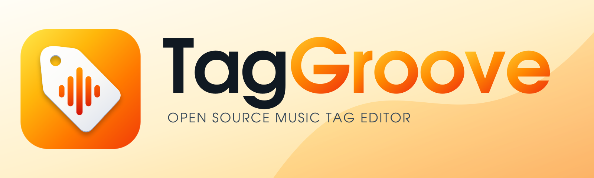

<picture>
  <source media="(prefers-color-scheme: dark)" srcset="assets/brand/TagGroove-Brand-Kit/03-banners/taggroove-readme-dark-1600x480.svg">
  
</picture>

# TagGroove

[](https://github.com/johnneerdael/TagGroove/releases)
[](COPYING)

**Tag, Organize, Enjoy.** An open source music tag editor for Windows, macOS, Linux, Android and iOS.

An independently authored open source reconstruction of Mp3tag 3.36.1 using Tauri 2 and a Rust tagging engine. Exact feature and performance parity remain the project goal. The [parity ledger](docs/PARITY.md) lists missing behavior and unresolved semantics; [performance measurements](docs/PERFORMANCE.md) retain their tested scope. The [remaining-work priorities](docs/handover/PARITY-PRIORITIES.md) explain user impact, work type, effort and required environments.

The desktop editor loads audio folders, edits common and extended multi-value tags, manages embedded covers, previews filename conversion, edits ordered action groups, numbers tracks, looks up tags from online sources, and exports through MTE templates and playlists. Audio edits stage and verify a copy before replacing the file. Generated fixture tests check preservation of audio packet hashes, unknown fields and covers across multiple formats. The supplied TagGroove brand kit provides the interface identity and platform icons.

Current remainders include a separate floating tag-panel window, mobile action execution and additional container/profile compatibility. This branch repairs the confirmed scripting, action-file, Lyrics3v2 and playlist-identity defects and adds full-content checks for observed concealed external edits during Save and Undo/Redo, persistent eligible desktop history and verified-copy interruption recovery; those repairs still require final reviewed integration. Review the [current remainders](docs/PARITY.md#uncovered-work) before migrating these workflows. Outstanding reference/platform checks for implemented features live separately in the [qualification register](docs/research/remaining-gaps.md#qualification-of-implemented-scopes).

## Download

Get platform installers from the [latest GitHub release](https://github.com/johnneerdael/TagGroove/releases/latest). Reviewed merges that change shipping files enter the release pipeline; publication waits for all required packages, source archives and verification gates. Versions follow the `0.2.1`, `0.2.2`, … sequence; docs-only merges do not advance it. Release assets include checksums and identify their operating system and architecture.

See [release automation](docs/RELEASING.md) for build targets, signing status and publishing instructions. Simulator previews are labeled separately from device installers.

## User guide

Read the [TagGroove user guide](https://taggroove.neerdael.nl/) for your first tagging session, practical recipes, and format-string and regular-expression references. The guide is growing; unfinished topics stay out of the published site.

See [documentation publishing](docs/PUBLISHING.md) to contribute or check a deployment.

## Develop

Install the official Tauri 2 prerequisites for the target OS, current stable Rust, a C++17 compiler, and Node.js 22. The regex bridge vendors open source Boost.Regex under its included Boost Software License. FFmpeg/ffprobe enable the encoded-format fixture tests.

```sh
npm ci
npm run tauri dev
```

```sh
npm run build
npm test
cargo clippy --workspace --all-targets --locked -- -D warnings
npm run tauri build
```

Builds run through the reviewed pull-request workflow (see `.github/CI_LOCKDOWN.md`) for Windows, macOS and Linux. Local macOS validation is not proof of the other platforms. Android and iOS builds exist. Android document access still needs device verification, and iOS document access and save-back are not implemented yet.

## Evidence

`docs/evidence/inventory.py ../` reproduces the resource-derived feature inventory against the separately supplied executable. The executable and vendor icons, templates, translations and source scripts are not part of this application. REA evidence references distinguish static observations from inferred behavior and runtime verification. Tests of this implementation are separate from original-app differential tests.

## License

The combined application is distributed under GPL-3.0-only because its native Beatport and Traxsource adapters adapt OneTagger-derived CueRithm code. See [COPYING](COPYING) and [catalog source provenance](crates/catalog-sources/README.md). Existing independently authored MIT components retain their [MIT license](LICENSE); third-party dependencies retain their own notices. The original Mp3tag software remains the property of its author.
