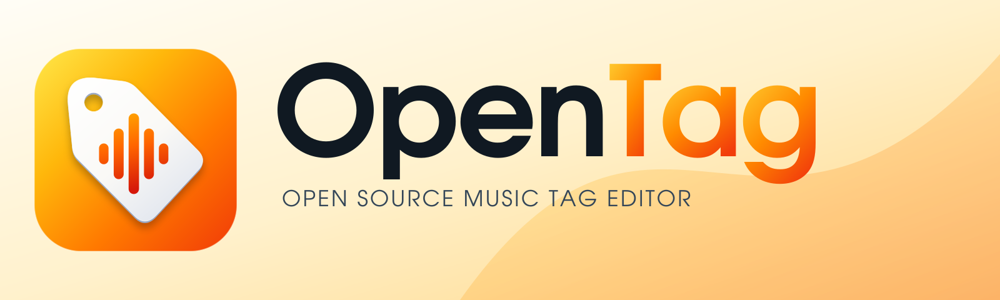

<picture>
  <source media="(prefers-color-scheme: dark)" srcset="assets/brand/OpenTag-Brand-Kit/03-banners/opentag-readme-dark-1600x480.svg">
  
</picture>

# OpenTag

[](https://github.com/johnneerdael/opentag/actions/workflows/build.yml)
[](https://github.com/johnneerdael/opentag/releases)
[](LICENSE)

**Tag, Organize, Enjoy.** An open source music tag editor being built for Windows, macOS, Linux, Android and iOS.

An independently authored open source reconstruction of Mp3tag 3.36.1 using Tauri 2 and a Rust tagging engine. The current build is incomplete. Exact feature and performance parity remain the project goal; see `docs/PARITY.md` and `docs/PERFORMANCE.md` for evidence and remaining work.

The desktop editor loads audio folders, edits common and extended multi-value tags, manages embedded covers, previews filename conversion, edits ordered action groups, numbers tracks, and exports CSV and M3U8 playlists. Action-driven MTE exports support loops, variables, partitions and encodings. Audio edits stage and verify a copy before replacing the file. Generated fixture tests check preservation of audio packet hashes, unknown fields and covers across multiple formats. The supplied OpenTag brand kit provides the interface identity and platform icons.

## Download

Get platform installers from the [latest GitHub release](https://github.com/johnneerdael/opentag/releases/latest). Every code merge to `main` publishes a new full release with all platform builds (versions `0.2.1`, `0.2.2`, …); the [parity ledger](docs/PARITY.md) tracks what is still incomplete before 1.0. Release assets include checksums and identify their operating system and architecture.

See [release automation](docs/RELEASING.md) for build targets, signing status and publishing instructions. Simulator previews are labeled separately from device installers.

## Develop

Install the official Tauri 2 prerequisites for the target OS, current stable Rust, a C++17 compiler, and Node.js 22. The regex bridge vendors open source Boost.Regex under its included Boost Software License. FFmpeg/ffprobe enable the encoded-format fixture tests.

```sh
npm ci
npm run tauri dev
```

```sh
npm run build
npm test
cargo clippy --workspace --all-targets --locked -- -D warnings
npm run tauri build
```

Windows, macOS and Linux build workflows are configured; local macOS validation is not proof of the other platforms. Android/iOS interfaces and document access are being implemented and require independent build/device verification.

## Evidence

`docs/evidence/inventory.py ../` reproduces the resource-derived feature inventory against the separately supplied executable. The executable and vendor icons, templates, translations and source scripts are not part of this application. REA evidence references distinguish static observations from inferred behavior and runtime verification. Tests of this implementation are separate from original-app differential tests.

## License

MIT for the independently authored application. Third-party dependencies retain their own licenses. The original Mp3tag software remains the property of its author.
