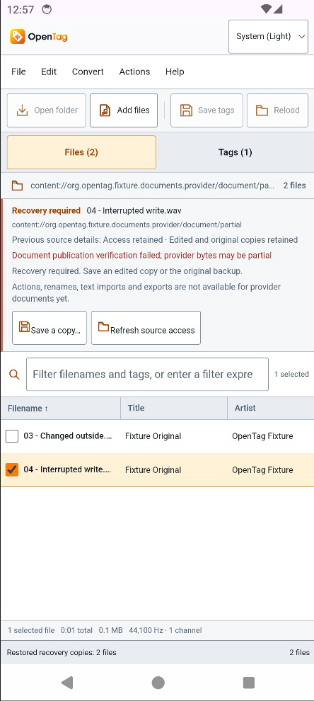
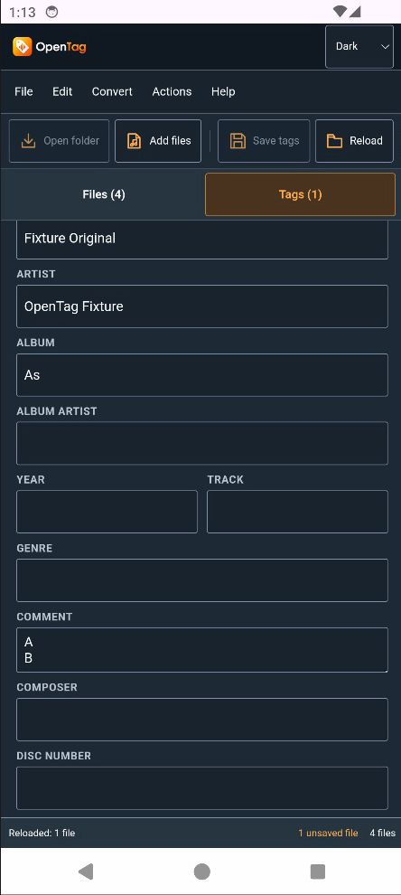
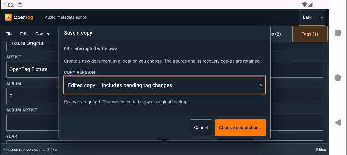

# Android document workflow qualification

Bounded native checks passed on the dedicated AOSP Android14/API34 arm64 AVD
`OpenTag_Document_Test_API_34`, using only the separate generated WAV provider
fixture. The Beatport library was not mutated. All device UI input and screenshots
used the native Android Studio device view through CUA; adb only installed test
APKs and collected bytes/logs. This is one emulator and one provider, not mobile
release, cloud-provider or complete Mp3tag parity certification.

The [machine-readable receipt](android-document-workflows.json) records exact
source/APK/native-library identities, source hashes, exported identities,
independent packet/PCM comparisons, lifecycle evidence and screenshot provenance.
The latest installed debug APK is source
`181e1974b28d249df8528803ca23adecc62449ef`, SHA-256
`d08fd5623d2f0df968860d9e94c75de196cf80eec69a8d51753f43c31c8d1c12`;
its embedded native library matches the isolated Rust build. Earlier native
cases are attributed separately to their actual source and APK.

## Verified workflows

| Case | Actual UI and independent result |
| --- | --- |
| Picker and Unicode | Cancel returns no added files and retains pending edits. Four generated documents load with the Unicode name and accurate writable/read-only states. The latest Dark build also picks the Unicode source. |
| Light save/reload | Album `A` and multiline Comment `A\nB` persist in the actual provider; Reload retains them. Exact audio packets and decoded PCM remain unchanged; all three unselected sources stay byte-identical. |
| Artwork | Add embeds the generated PNG's exact packet SHA-256 `474b5eebee61cae290e3ea03d32b80de333ced94c1ec69e69adc6ada45613f92`; Remove leaves no artwork packets. Audio and other tags remain intact. |
| Read-only copy | Direct save is disabled. Cancelling destination selection retains Album `R` and its unsaved state. Edited copy creates a distinct writable URI; Reload retains `R`. All original source bytes and audio remain intact. |
| Outside conflict | Fixture changes Title while preserving size and modification time. Save rejects the changed hash before any provider write-open. Original export exactly matches baseline bytes; edited export contains Album `C`. Neither export overwrites the outside change. |
| Partial write | Provider consumes 89,370 bytes but retains only 128. Fresh read-back detects failure. Full edited audio and immutable baseline remain available; original and Album `P` edited exports preserve exact audio. The provider's 128 bytes remain untouched by recovery exports. |
| Revoked restart | Revoke source access, make it unavailable, Force stop through Android Settings, confirm no process, then launch the same APK with a new PID. Recovery restores Album `C` without a picker or provider events. Edited export exactly matches retained edited bytes. Ready records stay closed. |
| Latest Dark save/reload | On source `181e197`, edit Unicode source Album `A` to `As`, Save and Reload. Comment `A\nB` and exact audio remain intact; all ten other provider documents stay byte-identical. |
| Latest keyboard and copy | Native Next navigates Title through Comment. Multiline `A\nB` remains visible and focused. One Back dismisses the keyboard; the first File tap also dismisses it while preserving the open menu. A new edited copy contains Album `P` plus the multiline Comment with exact audio preserved. |
| Orientation and menus | An open Dark copy dialog remains usable in landscape. Returning to portrait retains selection and the open Help menu. Convert/Actions menus are exclusive and show disabled provider operations with an explanation. |

## Defects found and corrected

Opening File > Save a copy originally crashed WebView113 before a destination
was chosen, with or without a draft. The same dialog opened from the source
panel survived. A separate diagnostic native WebView APK reproduced this with
the actual compiled frontend and mock command transport, isolating frontend
layout from provider mutation. Matching renderer dumps trapped during outline
collection of an empty layout-fragment list. Explicitly excluding closed
menu panels from layout prevented it; the actual patched OpenTag APK then
passed repeated menu/dialog open/cancel and real copy workflows.

Keyboard dismissal originally triggered a whole-app resize redraw that focused
a replacement input and reopened the keyboard. Same-mode resizes now refresh
table geometry without replacing editor/menu nodes; a real desktop/compact
breakpoint crossing still renders the required context. Native Back/menu and
multiline checks passed on the rebuilt APK. Finally, recovery access metadata
is labelled as previous source details, since startup deliberately restores
local bytes without rechecking a potentially revoked provider grant.

These fixes preserve normal focus indicators, native dialog semantics and the
existing publication/recovery protocol. No WebView upgrade, global flag or
permission expansion was used.

## Evidence and remaining scope

Local immutable receipts are under
`/tmp/opentag-user-test/receipts/android-documents/`. The tracked JSON indexes
artifact hashes, per-case comparison results and original screenshot/crop hashes.
Original logs/minidumps, diagnostic source archive, full screenshots and per-file
ffprobe/PCM receipts remain there. The [receipt collector](android-document-receipts.py)
performs no UI input and refuses other AVD names.

Landscape keyboard typing, native Android system-bar theme synchronization,
other APIs/physical devices/providers, cloud behavior and iOS security-scoped
editing are not qualified. Provider actions, renames, text imports, exports and
directory trees remain subsequent parity work. Whole-branch review and hosted
Android/desktop CI are still required before delivering this integration.
