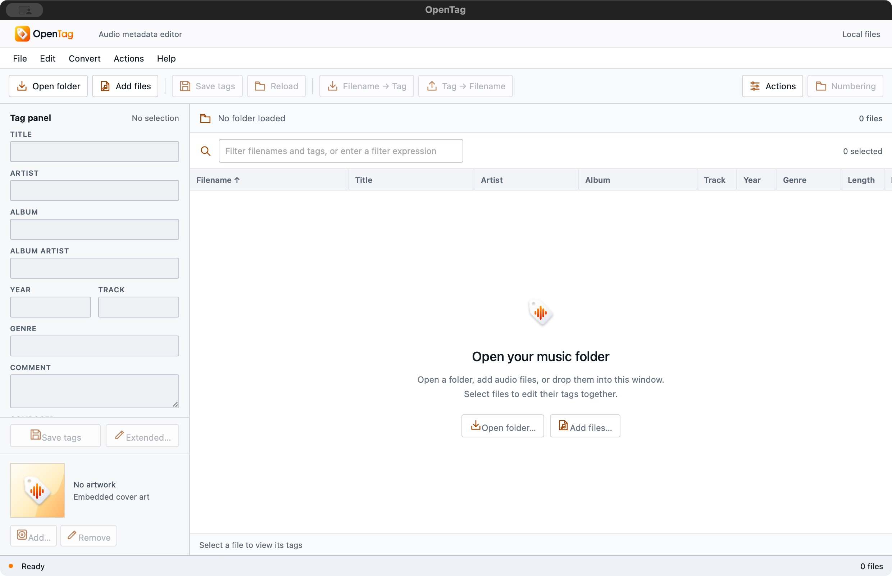
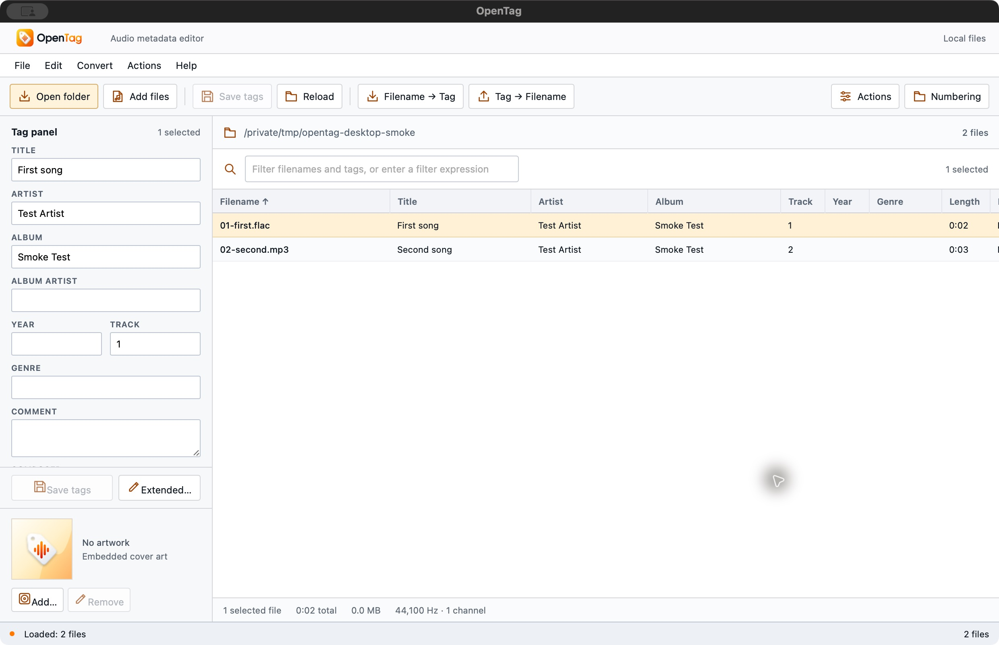
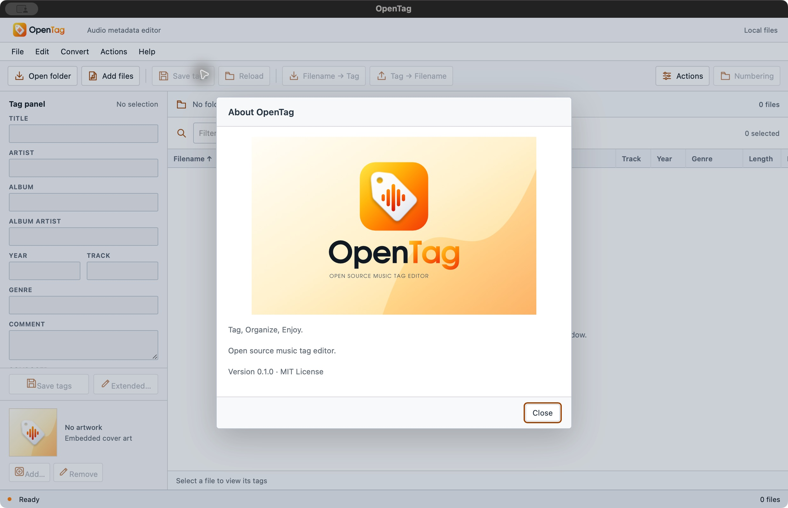
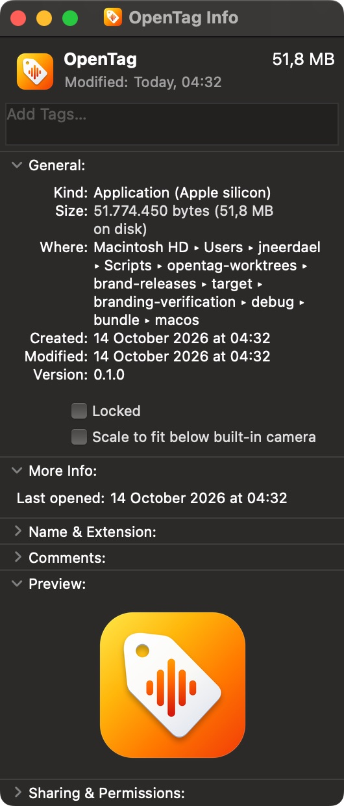
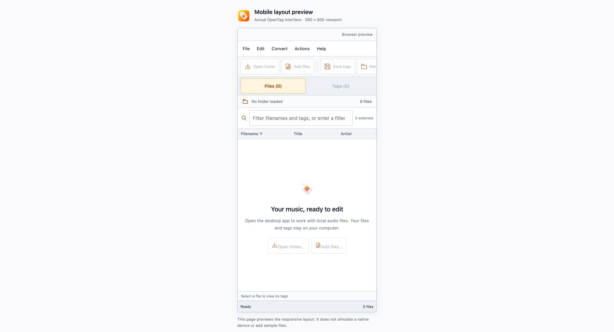

# Branded application visual proof

On 2026-10-14, the macOS arm64 debug app was built in the isolated `brand-releases` worktree using Rust 1.95.0 and `target/branding-verification`. The build and `codesign --verify --deep --strict` exited 0. The signature is ad-hoc; this app is not notarized.

Native CUA launched the exact built bundle, and the running executable path matched `target/branding-verification/debug/bundle/macos/OpenTag.app/Contents/MacOS/opentag`. Screenshots show the supplied header/logo, glyphs, empty view, fallback artwork, About artwork, tagline, version `0.1.0 · MIT License`, and the actual Finder-rendered application icon. The bundled ICNS exactly matches the provided source copy.

The [source/artifact receipt](branding-app-proof.json) records the source hashes, binary hash, icon hash and screenshot hashes. Its snapshot starts at commit `1cfd2527dc1c45a0a1a5c471465dcfbd45d76818` plus the recorded uncommitted branding changes. `action_host.rs` changed afterward for the Windows output-path fix; these screenshots prove this build-time branding snapshot, not that later native helper. No styling, assets, configuration or application source was edited during this verification.

The two existing disposable files under `/tmp/opentag-desktop-smoke` loaded with real metadata. No tag-save action ran; both file hashes remained unchanged.

The actual production browser app also rendered inside the existing 390×800 iframe preview, with zero files and native operations disabled. The current Chrome profile client-blocks/collapses its header logo image: development SVG module requests report `net::ERR_BLOCKED_BY_CLIENT`; the production image has natural width0 and computed `display:none` despite the app stylesheet specifying `display:block`. Browser extensions/security settings and all supplied artwork remained unchanged. This screenshot verifies the responsive layout and honest browser empty state, not full browser-logo rendering or native mobile/device behavior.

