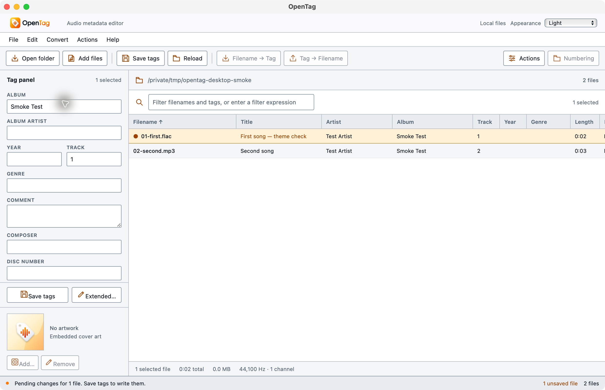
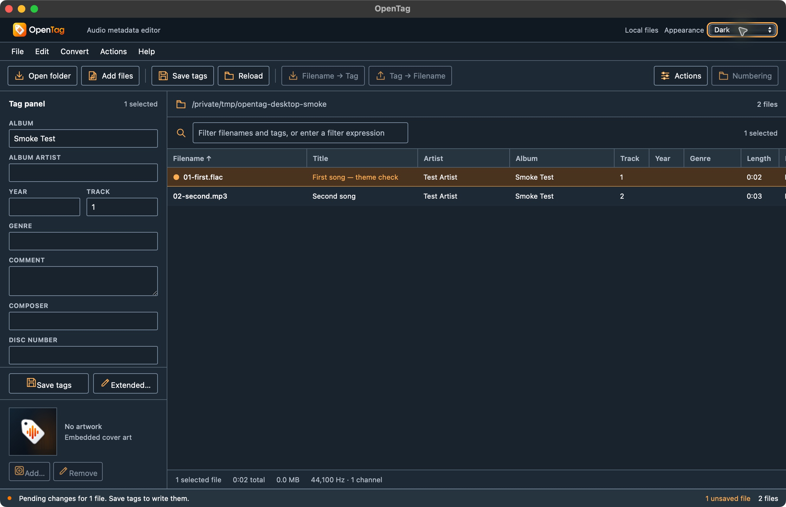
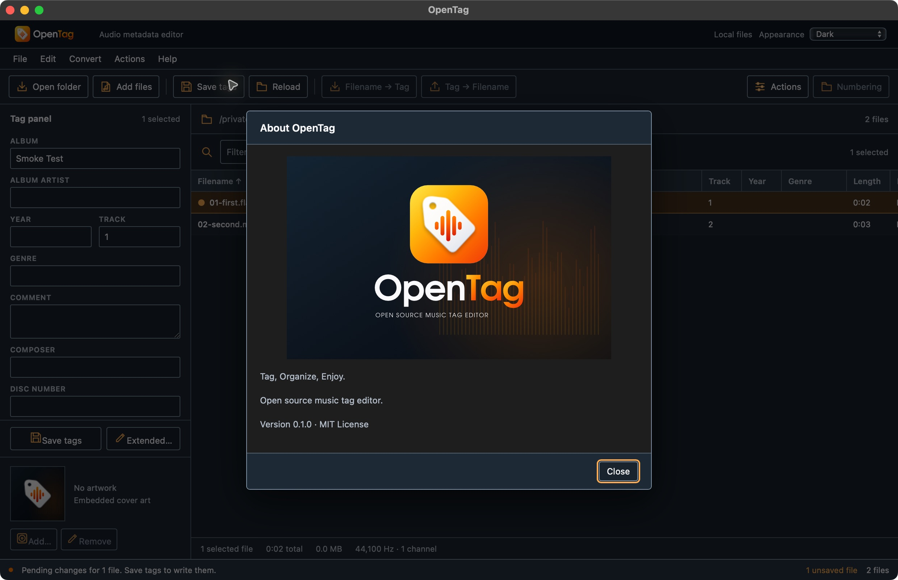
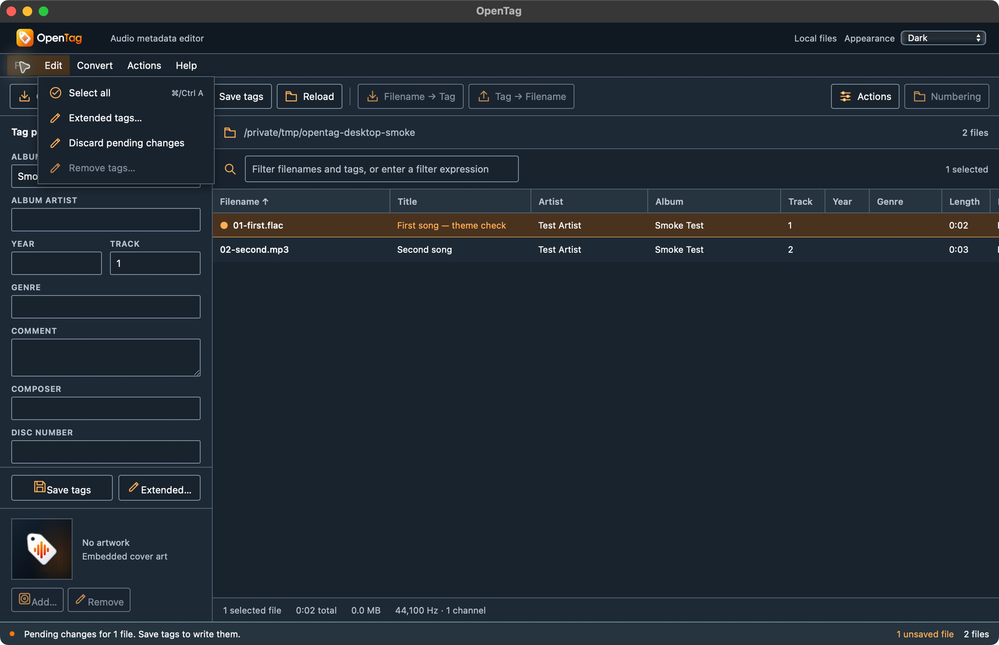

# Appearance implementation and verification

The header Appearance control provides System, Light and Dark. System is the default and shows the resolved mode. Manual selection is stored under `opentag.appearance` in the app origin's local storage. Invalid stored values return to System; unavailable storage leaves a usable in-memory choice.

The controller listens to `prefers-color-scheme` changes only while System is selected. Explicit choices ignore those changes. Theme changes update the document's semantic CSS variables and supplied artwork image sources in place; they do not rebuild the workspace or touch file metadata. The supplied dark/light horizontal logos, default artwork, empty-state marks and About images remain unchanged. Embedded cover bytes never participate in theme switching.

On desktop, native theme updates are serialized through `getCurrentWindow().setTheme(choice)` or `setTheme(null)` for System. Only `core:window:allow-set-theme` was added to the existing main-window capability. Tauri documents this as app-wide on macOS/Linux and unsupported on Android/iOS; native calls are skipped for those mobile families. No operating-system preference is changed. The web appearance selector remains enabled in browser previews while native file operations remain disabled.

Semantic contrast measurements use WCAG relative luminance over the actual opaque token colors:

| Pair | Contrast |
| --- | ---: |
| Light text / surface | 17.73 |
| Light muted text / surface | 6.36 |
| Light accent / surface | 6.63 |
| Light control border / surface | 3.22 |
| Dark text / surface | 15.28 |
| Dark muted text / surface | 8.91 |
| Dark accent / selected row | 6.39 |
| Dark control border / surface | 4.86 |
| Dark error text / error surface | 10.45 |
| Ink text / Orange button | 6.70 |

`npm run build` passed. `npm run test:ui` passed all 32 tests, including six focused controller tests for default/invalid values, OS following, explicit override, persistence across controller recreation, unavailable storage and disposal. The isolated macOS debug bundle built and signed ad-hoc successfully after the final landscape header rule. This is not notarization or mobile-device proof.

Native CUA testing verified System initially resolving to Dark, explicit Light and Dark, native title-bar changes, supplied logo/default/About variants, readable menu/field/selection colors, a pending title edit surviving Light→Dark, unchanged selected file, preserved tag-panel scroll (Album remains the top visible field) and focus remaining on the Appearance selector. The pending edit was discarded through the confirmation dialog; no save ran. The first visual pass caught and corrected a named `background:white` in the files pane before these final passing captures.

After the top-menu fix, native CUA selected Light, quit the empty app, and relaunched the exact bundle. Light and the supplied light logo persisted. Selecting System then restored Dark, including the native title bar. Captures: `branding-theme-restarted-light.png` and `branding-theme-returned-system.png`. No operating-system preference was changed.

Chrome device preview was operated through native CUA with explicit 390×844 portrait and 844×390 landscape dimensions. The Appearance selector remained visible and usable: portrait switched to Light and landscape switched to Dark. Captures: `branding-theme-phone-portrait.png` and `branding-theme-phone-landscape.png`. The client extension blocks some brand image requests in Chrome; native captures establish the supplied image rendering. The viewport override and DevTools were restored, and the temporary test tab was closed. These checks establish responsive appearance controls, not mobile file editing or device certification. The landscape workspace remains cramped, with little tag-field space and a partly clipped empty state; broader mobile interaction acceptance stays open.

Primary references: the installed `@tauri-apps/api/window.d.ts` setTheme contract and [Tauri core permissions](https://v2.tauri.app/reference/acl/core-permissions/).
