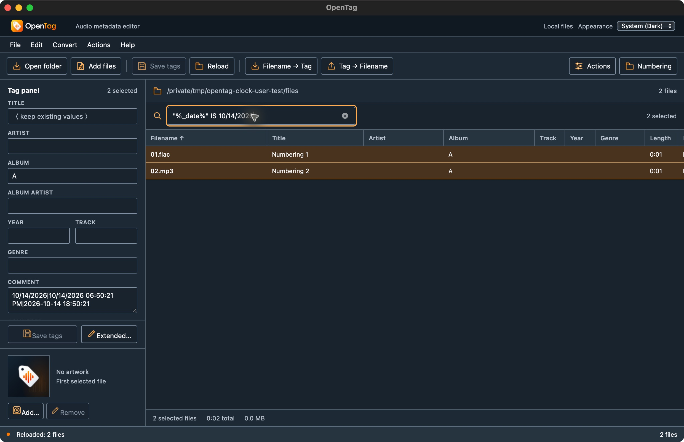

# Live clock fields and custom field lookup — 2026-10-14

The [official format reference](https://docs.mp3tag.de/format/) documents `%_date%` and `%_datetime%` as current date/time information. OpenTag previously returned an empty string unless callers supplied an arbitrary field with that name. Both now resolve from the evaluation clock, locale, and time zone instead of stale metadata snapshots.

The shared evaluator snapshots an unspecified clock once per expression. Native evaluation settings capture one instant for each operation and pass it through columns, action groups, filename conversion previews, and action exports. Direct filter selectors and scripted selectors use the same clock. `$meta`, optional sections, Boolean expressions, and filename templates also resolve these fields. `$list` continues to list raw tags without adding clock fields.

A second lookup defect expanded the custom name `maß` into the distinct ASCII name `MASS`. Script lookup and filter parsing now preserve non-ASCII characters while retaining ASCII case-insensitive field matching. This follows the application's existing native field-identity policy; it does not certify every original Unicode comparison rule.

## Verification

- **99 frontend + 270 Rust tests passed**, including six new core cases and one native operation-context case.
- Deterministic core tests pin `2001-02-03 04:05:06 UTC`, exercise US/German locale formatting, cross midnight with a negative time-zone offset, compare direct/scripted filters, render export clock fields outside/inside loops, check filename component handling, reject invalid clock contexts, and distinguish custom field names.
- The existing 72-placeholder fixture now pins a clock and expects live values for the two clock fields. Supplied values for other placeholders remain resolver checks, not evidence that all application producers exist.
- Strict workspace/all-target Clippy, formatting, diff checks, frontend production build, and native macOS debug packaging passed. No dependency or release-version changes were needed.

## Native desktop workflow

The app at `/tmp/opentag-clock-user-test/OpenTag.app`, identifier `org.opentag.editor.usertest.clock`, was built from the accompanying source. UI testing used System Dark and two disposable generated FLAC/MP3 files; the user's music library was not edited.

Select both files and run a Quick Format Value action on COMMENT:

```text
%_date%|%_datetime%|$fmtDate('yyyy-MM-dd HH:mm:ss')
```

The action and Reload both reported two successes. Both saved comments were exactly:

```text
10/14/2026|10/14/2026 06:50:21 PM|2026-10-14 18:50:21
```

Direct `_DATE IS 10/14/2026` and scripted `"%_date%" IS 10/14/2026` filters each displayed both files. `_DATETIME MISSING` displayed none. Clearing the filter restored both rows. Independent `ffprobe` reads verified the saved comments and unchanged titles. Decoding with `ffmpeg` produced the same PCM bytes recorded before editing for both files. The app ended with two selected files and no pending drafts.



The first native text-entry attempt changed a quote into a typographic quote and was rejected as an unterminated literal. Pasting the exact expression succeeded. Automatic quote substitution remains an input issue to address, not a tested fix in this checkpoint.

See [clock-context.json](clock-context.json) for structured results. Raw fixtures, saved values, and audio copies remain in `/tmp/opentag-clock-user-test`; test/build logs are `/tmp/opentag-clock-tests.log` and `/tmp/opentag-clock-build.log`.

Original-runtime date formatting, custom OS regional preferences, Windows/Linux native workflows, full Unicode comparison equivalence, and other missing placeholder producers remain open. No inventory acceptance statuses or broader parity certifications changed.
