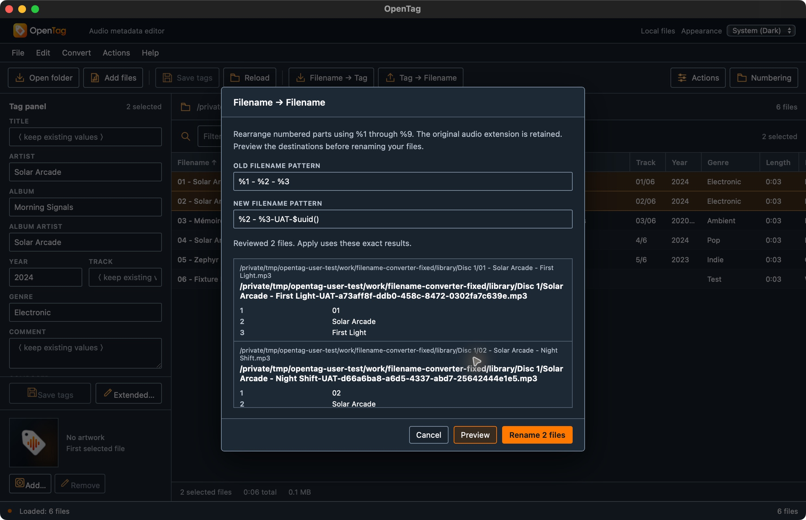
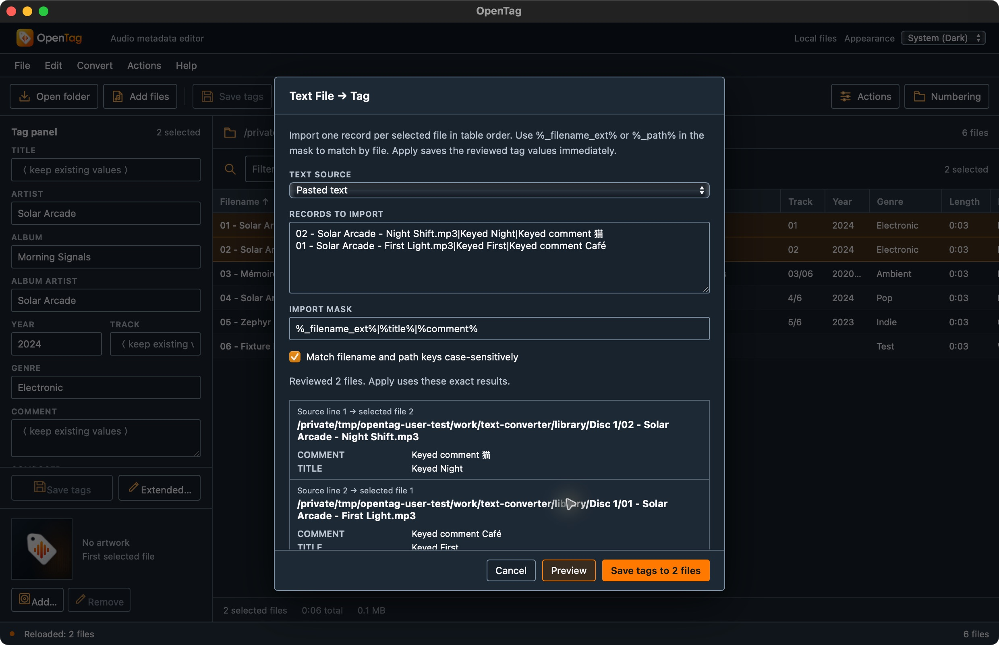

# Native converter workflow checkpoint

On 2026-10-14, the actual macOS arm64 native app exercised the new
**Filename → Filename** and **Text File → Tag** dialogs through visible controls
and native file pickers. Both workflows passed within the desktop cases below.
Only two disposable MP3s were selected for mutation in each six-file fixture
library under `/tmp/opentag-user-test`; no user music library was used.

This is a source/debug-build checkpoint, not public-release binary
qualification or exact Mp3tag parity. [Measured results and evidence paths](converter-workflows.json)
identify each input, reviewed destination, native AX/screenshot and independent
file/audio receipt. [The converter audit](../CRITICAL-CONVERTERS.md) retains the
native transaction boundaries and legacy-endpoint gaps.

## Tested build and source identity

The fixed filename replay and both text-import modes used the isolated bundle
`/tmp/opentag-user-test/bundles/desktop-unique/OpenTag.app`, with identifier
`org.opentag.editor.usertest.desktop` and executable SHA-256:

```text
ea605ca210c821eb49e7720001877f775c6454a5159522b9e41c5b57ae149307
```

`/tmp/opentag-user-test/receipts/native-build-parity-desktop-unique.json` records
the actual bundle/executable identity. Its functional source hashes and archives
match `native-build-parity-preview-fix.json`; only the application identifier
was changed for the separate desktop profile. Base commit
`b15635360ad0f48d6f1b3ceef376b1aa3eaef07a` alone does not identify the tested
dirty source tree. The tracked patch SHA-256 is
`3e8875218c3a488f829093f74f32e731a645a4671ff1cb30992ce9adaed7f9d6`;
the archived untracked source SHA-256 is
`49a25407ac26045b36b6d4288ffdb39b32bfe4ee4fdebf5e978f1a59d00e99db`.
Both archive hashes were independently checked for this document.

The recorded validation checkpoint passed 52 Node tests, 47 native tests, the
full workspace suite, strict clippy, formatting, frontend build and native
build. These are supporting checks, not substitutes for the actual UI/file
results below. This documentation task did not rerun builds or operate the GUI.

## Filename → Filename: passed after first-activation fix

The initial `filename-converter` run reproduced a user-visible event-order
problem. After editing the patterns, the first Preview reported
`Inputs changed. Run Preview again.` and left Rename disabled. A second Preview
worked: Apply and Reload used exactly the reviewed UUID destinations, and all
six complete file contents and encoded/decoded audio were preserved. That
workaround did not qualify the first activation as passing. Its original AX,
assertions, destinations and executable identity remain in the JSON as a
separate initial attempt.

After the input/change focus-order fix, a fresh `filename-converter-fixed` case
passed on the unique desktop build. The first Preview immediately accepted the
two reviewed rows. Editing the new pattern disabled Rename and cleared the old
review; a fresh Preview was required. The final inputs were:

```text
OLD: %1 - %2 - %3
NEW: %2 - %3-UAT-$uuid()
```

Apply and Reload produced these exact final reviewed filenames in `Disc 1`:

```text
Solar Arcade - First Light-UAT-a73aff8f-ddb0-458c-8472-0302fa7c639e.mp3
Solar Arcade - Night Shift-UAT-d66a6ba8-a6d5-4337-abd7-25642444e1e5.mp3
```

Both former source paths were absent, both reviewed targets existed, and their
complete-file hashes matched the originals. All six encoded-audio packet and
decoded-PCM identities were unchanged. Preview itself modified no files.

A new pattern referencing `%2` when only `%1` was declared produced an explicit
undefined-part error and blocked Rename. After correcting the new pattern to
`%1` with old pattern `NO MATCH %1`, the actual error was
`Filename does not completely match the pattern`; Rename remained disabled.
Cancel introduced no additional mutation. These are preview/error/cancel
results, not a claim that every native Apply failure branch was exercised.

Receipts are under
`/tmp/opentag-user-test/receipts/filename-converter-fixed/`:
`before.json`, `preview.json`, `reviewed-destinations.json`,
`applied-reloaded.json`, `assertions.json`, their comparisons and native AX.
The initial failure/workaround remains under `receipts/filename-converter/`.



## Text File → Tag: file and pasted-keyed modes passed

In a fresh `text-converter` case, both MP3s were selected in table order. A
malformed source file with mask `%track%|%artist%|%title%` reported
`Text import line 2 does not completely match the mask`. Independent receipts
showed all six files byte-identical: a valid first line did not partially write.

The BOM-marked UTF-16 file `import-positional-utf16.txt` was chosen through the
actual native picker. The first Preview displayed Imported First/Imported
Second. Toggling case-sensitive matching off and back on invalidated the review
on both changes; restoring the option did not resurrect its old receipt. A fresh
Preview, Apply and Reload persisted:

| Selected file | TITLE | TRACK |
| --- | --- | --- |
| First Light MP3 | Imported First | 01 |
| Night Shift MP3 | Imported Second | 02 |

Independent ffprobe tag dictionaries equalled their originals with only those
title/track replacements. The imported ARTIST values were identical to their
existing values. All other tag values survived, four unselected complete files
were unchanged, and all six encoded/decoded audio identities matched baseline.

The dialog then switched to Pasted text with this mask and reversed records:

```text
%_filename_ext%|%title%|%comment%

02 - Solar Arcade - Night Shift.mp3|Keyed Night|Keyed comment 猫
01 - Solar Arcade - First Light.mp3|Keyed First|Keyed comment Café
```

The native preview visibly mapped source line 1 to selected file 2 and source
line 2 to selected file 1. This preview left every file unchanged relative to
the **already saved UTF-16 checkpoint**, not the pristine baseline. Apply and
Reload persisted TITLE/COMMENT `Keyed First` / `Keyed comment Café` on First
Light and `Keyed Night` / `Keyed comment 猫` on Night Shift. Tracks remained
`01`/`02`; every other tag dictionary value matched the UTF-16-saved state.

The four unselected complete files stayed identical and all six audio payloads
were preserved throughout. Cancelling another converter dialog introduced no
further mutation. Receipt files under
`/tmp/opentag-user-test/receipts/text-converter/` include `before.json`,
`malformed-preview.json`, `utf16-preview.json`, `utf16-applied-reloaded.json`,
`keyed-preview.json`, `keyed-applied-reloaded.json`, `assertions.json`, comparison
files and native AX/screenshots. The exact independent dictionary comparisons
and selected screenshot hashes are recorded in the companion JSON.



## Qualification limits

These are bounded macOS desktop success, preview-validation, review-invalidation
and cancel observations on two selected MP3 fixtures. No native converter
mutations to the other formats, Windows/Linux UI, Android/iOS UI,
document-provider/save-back flow, mobile portrait/landscape layout or original
Mp3tag differential corpus is qualified here. Legacy-codepage selection,
case-insensitive matching outcomes and absolute `_path` keyed import were not
exercised in these UI cases; the checkbox test establishes invalidation only.

The five-minute wall-clock expiry and native Apply stale-source, permission,
rollback/recovery error branches remain NOT RUN in the UI. Existing unit/service
tests are separate evidence for those protections. Technical-field/filter,
native cover-export and mobile/provider workflows are separate root-owned
checks; this document does not mark them complete or claim all parity complete.
