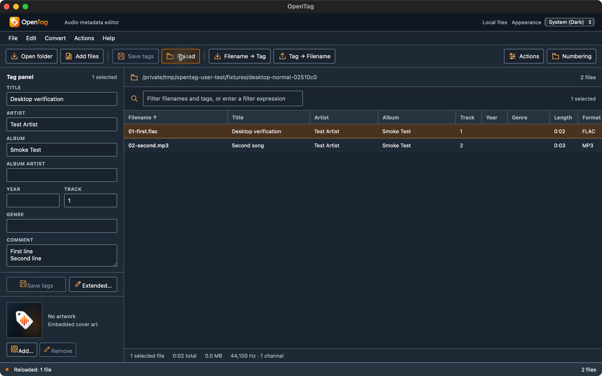
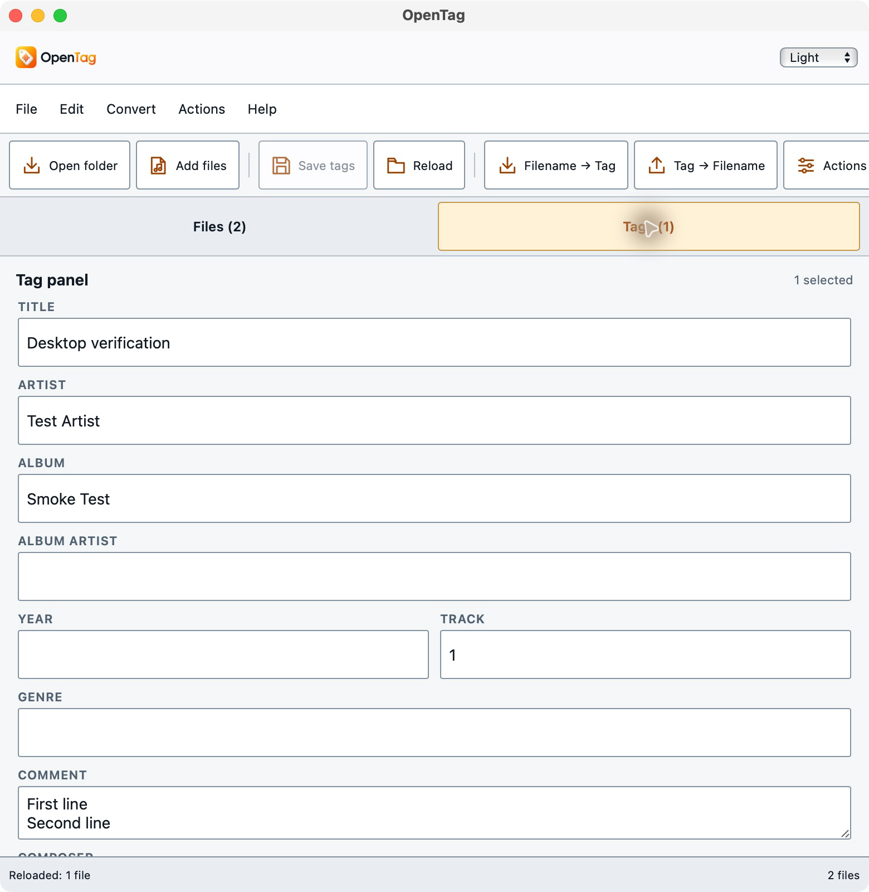

# Document editing review and delivery checkpoint

The implementation at `02510c00437da085b1481f625cbb369c435564c3` passed the full
branch review after one correction and all four hosted build/test jobs:
[Windows, macOS, Linux and Android run](https://github.com/johnneerdael/opentag/actions/runs/38566406618).
[PR #7](https://github.com/johnneerdael/opentag/pull/7) remains a draft.
The [machine receipt](document-editing-review.json) retains exact build identities,
CI job results, downloaded Android JUnit counts and screenshot provenance.

## Review correction

After an immediate tag or artwork operation could not be saved to its provider,
the UI could still show previously read metadata while the retained edited file
had changed. The correction refreshes affected entries from local working files,
updates artwork, and preserves the operation error and pending field choices.
If retained metadata cannot be read, the interface explicitly labels it as
unavailable instead of implying the displayed values describe the edited copy.

The read-only `document_working_entries` app command reads managed local working
files without reopening the provider or replacing them with backup contents.
No core tag schema changed. The previous reset/Discard behavior remains covered.
The corrected source passed 95 frontend tests, 243 Rust tests, strict Clippy,
formatting and the production frontend build. Independent scoped re-review passed.
Hosted Android reports contain six app viewport tests and 16 plugin tests with
zero failures or errors.

## Ordinary desktop UI checks

A fresh macOS test app with a separate application identifier opened copies of
two generated audio files. Through the actual UI, the FLAC Title was changed to
`Desktop verification`, a two-line Comment was added, and Save then Reload retained
both. Independent media inspection confirmed identical audio packets; the
unselected MP3 remained byte-identical.

System Dark and Light appearances rendered with the supplied branding. Resizing
from 1280 to 780 CSS pixels showed the compact Files/Tags interface and retained
selection and saved values. Returning to 1280 restored all desktop table columns.
File → Edit → Convert → Actions → Help kept exactly one menu open at each step;
Escape closed it.

## Explicit verification limits

The updated Android APK built successfully, but it has **not** been installed or
user-tested for the latest retained-metadata reconciliation change. The additional
diagnostic device sequence was stopped. No successful native replay of that
change is claimed. Existing [Android workflow evidence](android-document-workflows.md)
remains attributed to its actual earlier builds.

Physical devices, other providers, landscape keyboard typing, native Android bar
theming, iOS editing and full feature/performance parity remain open. CI, source
review and ordinary desktop UI checks do not establish those requirements.
