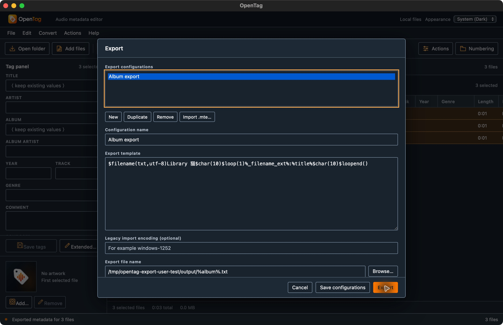
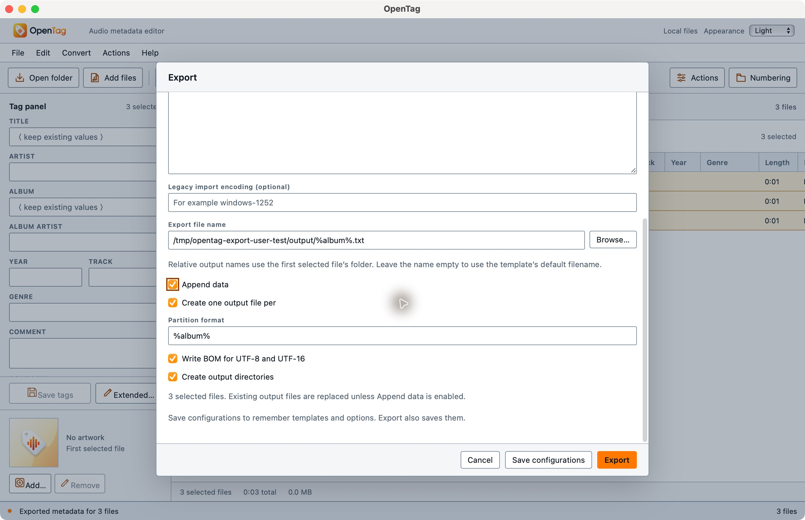

# Standalone export manager — 2026-10-14

The [Mp3tag export reference](https://docs.mp3tag.de/export/) describes a configuration list, editable templates, output filename, append and partition choices, and BOM/directory settings. OpenTag previously exposed a fixed CSV shortcut and export through action groups. It now has a persistent standalone workflow reusing the same MTE renderer.

## Delivered behavior

File → Export and Ctrl/Cmd E open a manager with configuration creation, duplication, renaming/editing, removal and MTE import. Management is available without selected audio; running export requires a supported selection with saved tag edits. Save persists the dialog's library/options. Cancel discards unsaved dialog edits. Export saves the current choices before executing.

Preferences include configuration selection, output filename, append, partition expression, BOM and output-directory creation. The export path retains the existing rendering/encoding checks and returns file errors without closing the manager. Export actions can use library display names and share saved global BOM/directory options while retaining their own output, append and partition settings.

Templates are actual UTF-8 MTE files at `export/<id>.mte` in the app configuration directory. `exports.json` stores identities, names and preferences. Reopening loads external MTE edits, including unfinished syntax that can be repaired before saving. Saving checks syntax first. Removed MTE files move to `export/removed/` and retain their contents. Library metadata and individual template/output files use staged replacement; the collection is not a multi-file transaction.

## Automated checks

**101 frontend + 279 Rust tests passed.** Two new frontend cases cover duplicate identity/content independence and removal/selection through an empty library. Nine new native cases cover settings roundtrip, rejected library edits, UTF-16 MTE import, external MTE editing/repair, MTE retirement, plain-text export templates, BOM/append/directory behavior with byte-identical source audio, displayed-name action resolution, and saved global BOM preferences.

Strict workspace/all-target Clippy, formatting, diff checks, TypeScript/Vite production build and macOS debug app packaging passed. The command serializers preserve the existing action result shape and the action export DTO. No dependency or release-version changes were needed.

## Native workflow evidence

The initial app is `/tmp/opentag-export-user-test/OpenTag.app`; the final app is `/tmp/opentag-export-user-test/final/OpenTag.app`. Both use test identifier `org.opentag.editor.usertest.export`. The final backend adds MTE retirement and shared saved BOM/directory options for Export actions; their frontend source is identical.

All interaction used native macOS arm64 Tauri WebKit. Input comprises three generated FLAC/MP3 copies across albums A and B. The user's music library was not edited.

The initial native run verified:

1. Open manager without a selection: editing enabled, Export disabled.
2. Create Scratch, duplicate it with an independent identity/name, remove configurations through an empty library, save and reopen the empty list.
3. Import a generated UTF-16 MTE, rename it Album export, edit its header to `Library 猫`, save, close and reopen.
4. Load/select three audio files and use output `/tmp/opentag-export-user-test/output/%album%.txt`, partition `%album%`, and UTF-8 BOM.
5. Disable directory creation: visible missing-directory error, dialog/options retained, and no output folder created. All input bytes remain unchanged.
6. Enable directory creation: exact outputs A.txt and B.txt, each with one BOM. Reopen the manager and verify all saved choices.
7. Inspect System Dark and Light, open via keyboard and File menu, then append a second exact data block without another BOM.

The final source build verified:

1. Restart into the persisted Light appearance and export choices.
2. Save a duplicate, remove/save it, and inspect storage: one active MTE and one retired MTE with identical template text.
3. Attempt to save an unfinished loop: visible syntax error and editable draft retained. Cancel/reopen restores the last valid template.
4. Load/select the same three inputs and run persisted partitioned append. A.txt and B.txt now each contain three exact blocks with one BOM.
5. Run a Quick Export action using the displayed configuration name Album export and its own action.txt output. The exact combined three-file result has the saved global UTF-8 BOM and a single data block.

Independent byte comparisons verify every output against expected content, each BOM occurs once, all three input audio files remain byte-identical, and the imported UTF-16 MTE remains byte-identical. The final app has three selected files and no pending tag drafts.

Structured results are in [export-manager.json](export-manager.json). Raw fixtures and comparisons remain under `/tmp/opentag-export-user-test`; final test/build logs are `/tmp/opentag-export-tests.log` and `/tmp/opentag-export-final-build.log`.

## Remaining parity requirements

This is not exact Mp3tag certification. Skip-selection-dialog and open-output preferences, the bundled template catalog, discovery of manually added MTE files without import, full original sort/locale/encoding comparisons, audio-only MD5, cuesheets and playlist imports remain open. Windows/Linux native and provider/mobile exports remain unqualified. Output files commit individually, and settings interruption behavior across multiple files remains unqualified. The broader inventory's acceptance statuses did not change.
