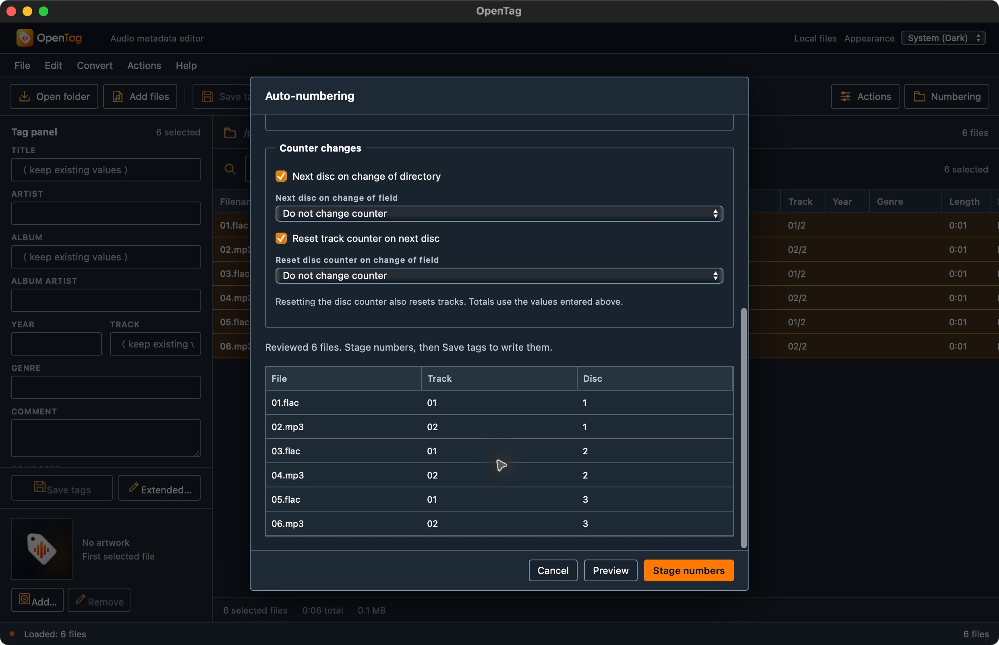
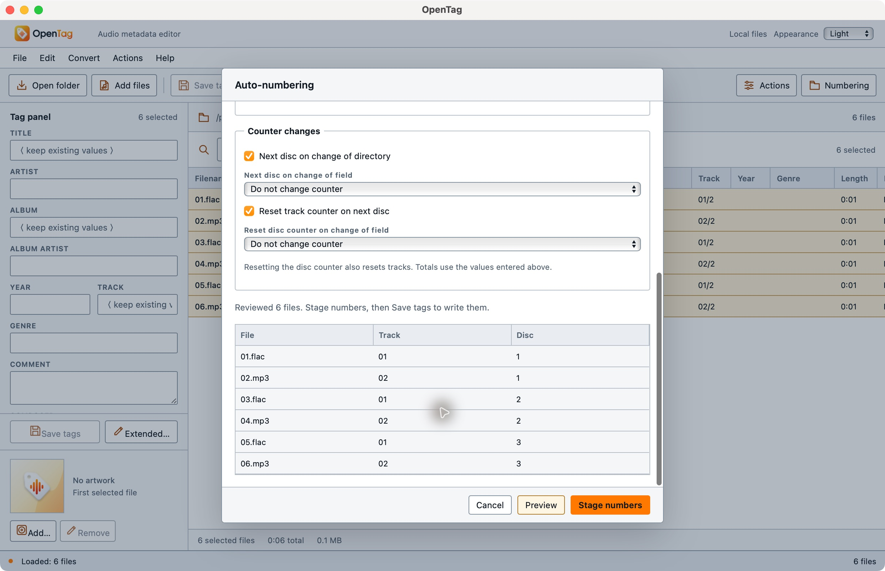

# Track and disc numbering checkpoint — 2026-10-14

This closes implementation gaps in the existing numbering operation. It does not certify exact Mp3tag 3.36.1 equivalence. The reference is the [official numbering documentation](https://docs.mp3tag.de/converters/auto-numbering/).

The Rust planner supports track and disc starts, optional explicit totals, minimum digits, directory and field transitions, track resets, and field-based disc resets. It computes the complete plan before returning any patches, detects numeric overflow, preserves selection order, and reads the original field snapshots for every transition. It performs no file I/O. The frontend stages logical patches through its existing per-format native field mapping and saves through the existing tag writer.

## Automated verification

- `npm test`: **99 frontend + 263 Rust tests passed**. Added eight planner cases, one Tauri command case, and four frontend cases covering counters, transitions, reset precedence, multivalues/custom fields, invalid/overflow inputs, consumed previews, and stale/malformed results.
- `cargo clippy --workspace --all-targets --locked -- -D warnings`: passed.
- `cargo fmt --all -- --check` and `git diff --check`: passed.
- `npm run build` and native macOS debug app packaging: passed. Packaging used separate test bundle identifiers. It is not a release or notarized distribution.

## Native macOS workflow

Test input consists of six generated one-second files, alternating FLAC and MP3, in three disc folders across two albums. The user's music library was not edited. All UI interaction used the actual native app.

1. Open the fixture folder, select all six in filename order, and use Cmd K.
2. Set track total 2, disc padding 2, disc total 2, directory increments, track resets, and an ALBUM disc reset.
3. Preview shows tracks `01/2, 02/2, 01/2, 02/2, 01/2, 02/2` and discs `01/2, 01/2, 02/2, 02/2, 01/2, 01/2`.
4. Changing the start disables staging and removes the preview. A zero start produces a visible validation error; restoring 1 and previewing succeeds.
5. Stage numbers. Compare all six whole files with their copies taken before staging: byte-identical.
6. Save tags and Reload. Six successes, no remaining drafts. Independent `ffprobe` reads match every planned track/disc value; titles remain unchanged. Decode every file with `ffmpeg`: PCM bytes equal the copies recorded before editing.

The functional run used `/tmp/opentag-numbering-user-test/OpenTag.app`. It found a global table minimum width that clipped the Disc preview column. The final build at `/tmp/opentag-numbering-user-test/final/OpenTag.app` changes only that preview width and its test bundle identifier. Rust and TypeScript numbering behavior is identical between these builds.

The final build was opened separately, loaded the saved fixtures, and exercised Cmd K, disc/folder increments and track resets again. The sequence was reviewed in System Dark and explicit Light, with all three columns visible. Cancel returned to a clean selection with Save tags disabled. This final layout check did not repeat the earlier save operation.

Machine-readable results are in [numbering.json](numbering.json). Local raw fixtures, saved results, and build/test logs remain under `/tmp/opentag-numbering-user-test` and `/tmp/opentag-numbering-*.log`.

## Remaining parity requirements

Original-runtime comparisons are still needed for padding widths, field comparison, totals, and simultaneous triggers. The wizard does not yet remember its options. Windows/Linux native interactions, the complete tag-format matrix, provider document numbering workflows, and saved-operation undo remain unqualified. This checkpoint does not alter the inventory's acceptance statuses or certify the broader parity goal.
