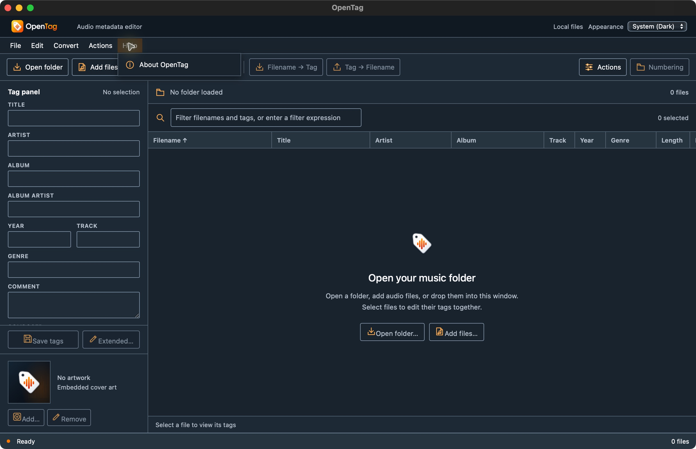

# First cross-platform publication run

The branded source and release workflow landed on main through PR #1 at
`b15635360ad0f48d6f1b3ceef376b1aa3eaef07a`. Its tree matches the fully passing
three-desktop CI head `7ec08a27e4bc1b6c8252ed53637b0563e3fefb5e`.

The actual [v0.1.0 publication run](https://github.com/johnneerdael/opentag/actions/runs/38511562000)
passed version/tag/source validation and produced the iOS arm64 simulator preview.
All five desktop packaging groups also succeeded. The Android setup job
failed before application compilation with `Failed to find package 'tools'`.
No GitHub release existed when checked after that failure.

`android-actions/setup-android@v3` defaults its package input to the legacy tools
package plus platform-tools. The correction explicitly requests platform-tools;
the action still installs command-line tools and performs its normal setup.
JDK, platform/build-tools 37, NDK, signing, source identity and publication gates
are unchanged. The [v3 action definition](https://raw.githubusercontent.com/android-actions/setup-android/v3/action.yml)
and [current upstream explanation](https://github.com/android-actions/setup-android#the-deprecated-tools-package)
support this bounded correction. Workflow lint passed, and a focused read-only
review found no blocker.

The corrected workflow requires a fresh run on its merged commit. Re-running the
old failed job retains the old workflow. Android compilation, all seven matching
artifact groups, digest checks and public release assets remain unverified until
that new run completes. A successful simulator package is not mobile runtime or
document-editing certification.

## API 37 package setup follow-up

The second [release run](https://github.com/johnneerdael/opentag/actions/runs/38513571736)
on merged commit `e7dbc39c3f0447bb8dbbc125c8b789b9de3776e4` passed the corrected
setup action, then failed the explicit platform installation with
`Failed to find package 'platforms;android-37'`. Android application compilation
had still not started; publication remains gated by this required job.

Google's [SDK repository metadata](https://dl.google.com/android/repository/repository2-3.xml)
publishes API 37 as `platforms;android-37.0`, revision 2, with minimum tools 22.
The same metadata provides command-line tools 22 as build `15859902`; the
[upstream action version table](https://github.com/android-actions/setup-android#sdk-version-selection)
confirms the build number. The workflow now requests that exact tools build and
platform package. Application compile/target API 37, JDK 17, build tools
37.0.0, NDK, signing and publication checks retain their previous settings.

`actionlint`, all 11 release-script tests, and whitespace validation passed for
this follow-up. A focused read-only review found no blocker. These checks do
not establish SDK installation or application compilation on the runner; a
fresh merged-source release run remains required.

## Published v0.1.0 and independent download verification

The third [release run](https://github.com/johnneerdael/opentag/actions/runs/38516775608)
succeeded on immutable main commit `e86c6fb85191a27ec4509585d5dc288b073152d8`.
All seven required build groups and the final publication job passed.
[OpenTag v0.1.0](https://github.com/johnneerdael/opentag/releases/tag/v0.1.0)
is public and marked as a development prerelease. The tag, release target and
public manifest identify that same commit. This source includes the native-UAT
export correction; the separate parity-core converter work is not in this tag.

All 15 public assets were downloaded again: 13 packages, the manifest, and
SHA256SUMS. Every downloaded size/SHA256 matched GitHub's asset metadata;
every package matched its manifest entry, and all 14 checksum-list entries
matched. The tagged release banner downloaded successfully and was byte-identical
to the supplied brand-kit PNG. Recorded hashes and platform coverage are in
[release-v0.1.0-results.json](release-v0.1.0-results.json).

The downloaded Android APK passed apksigner verification. Its certificate
SHA256 `d97ad94e5a900e8a6f460eef11c9670115f7cff73281488587426f3e551408e0`
matched the persistent project keystore's exported public certificate. Only
public verification data is recorded; private signing material stays outside
the repository.

The downloaded macOS arm64 app archive extracted successfully and passed
`codesign --verify --deep --strict`. That actual optimized published app was
launched through the native UI. File → Edit → Convert → Actions → Help left
exactly one top menu open after every step; Escape closed the last menu. The
empty workspace rendered the supplied dark logo and artwork placeholder.
The app then quit normally. No music was loaded or edited during this smoke test.

This qualifies publication, download integrity, the APK's project signing key,
and the stated macOS launch/menu smoke. Windows/Linux installation, Intel-Mac
launch, mobile runtime/document save-back, Apple notarization and full original
feature/performance parity remain separate qualification work. The iOS asset is
an unsigned debug simulator preview, and the Android asset is a signed UI preview;
neither mobile package is presented as a finished document editor.
