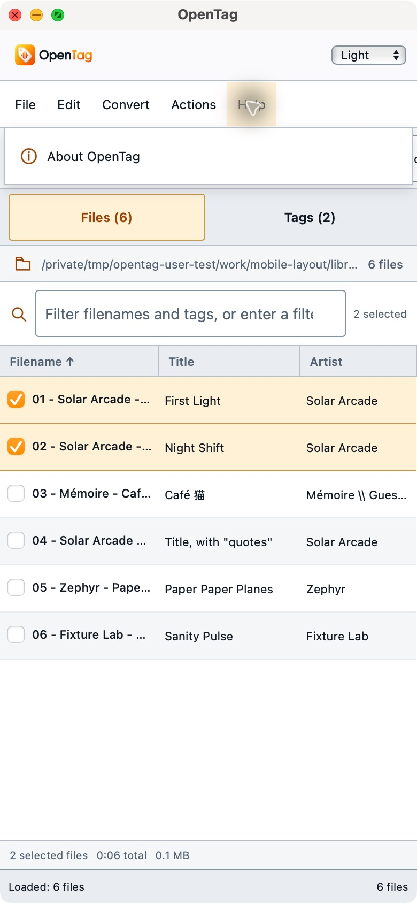
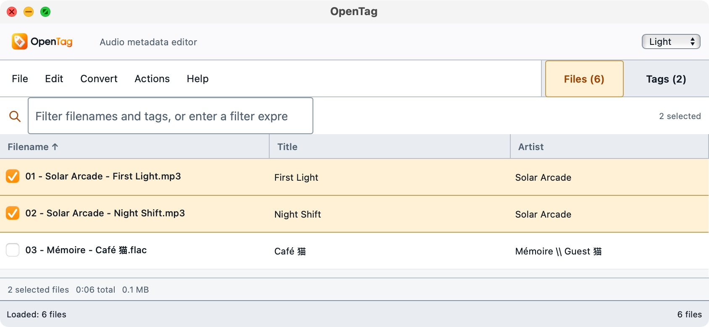
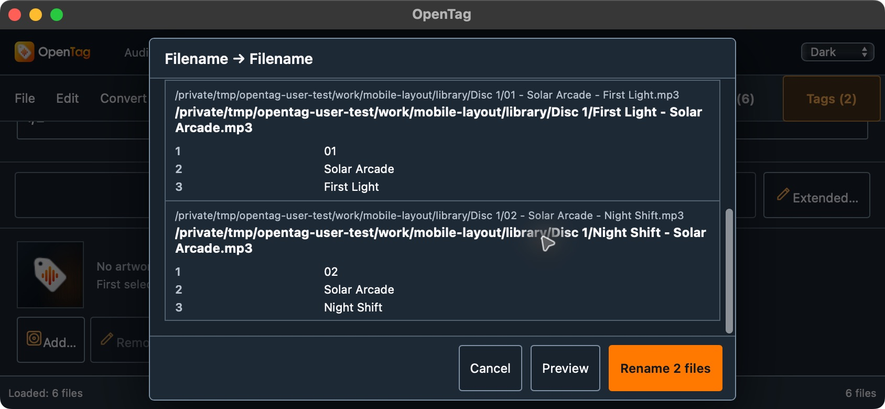

# Responsive native workflow replay

On 2026-10-14, native CUA exercised the isolated macOS arm64 Tauri app at a 390×844 portrait window, dragged it to 844×390 landscape, and returned it to 390×844. This is native macOS WebKit window geometry evidence, not an Android/iOS or physical-device test.

The executable SHA-256 was `1aac5851f9872cc3eabb816cc37136d0afb6686ee763d42e7f51f2727aa9fb8c`. The [compact receipt](responsive-workflows.json) records the source commit plus dirty-source identity, exact UI source hashes, original build-receipt hash and screenshot hashes. The identifier was isolated as `org.opentag.editor.usertest.mobilelayout`; test window minima were overridden to 320×320. This is not a byte-identical public release package or evidence that the regular desktop window's minimum size changed.

## Passed geometry and interaction checks

All five top-level menus—File, Edit, Convert, Actions and Help—switched exclusively in both sizes; retained AX snapshots show exactly the selected menu open. Escape dismissed the portrait menu. The Help popup fits within the 390px portrait window after the edge-positioning fix.

Landscape places menus and Files/Tags navigation in the same 44px row. The duplicate toolbar and read-only location row are hidden there. Both selected MP3s remained selected across the geometry changes and on returning to portrait. The file list scrolled to the final WAV. The whole Tags inspector scrolled to its Save/Extended controls and artwork in Light and Dark. A theme change visually left those bottom controls in view; no numeric `editor.scrollTop` assertion was made.

The Dark Filename → Filename dialog previewed both `First Light - Solar Arcade.mp3` and `Night Shift - Solar Arcade.mp3` from the two selected files. A Light Text File → Tag preview displayed `Landscape First` and Unicode `Landscape Second 猫`. In both dialogs, content scrolled while the header and footer action controls remained visible. Both were cancelled; Apply was not used in this responsive session. Returning to portrait retained the two selections, and a portrait Tags view was also captured in the retained source evidence.

## File preservation and limits

Independent `before.json` and `responsive-cancelled.json` receipts contain the same six fixture paths. Every complete-file SHA-256, ordered encoded-audio packet identity/count/byte total and decoded PCM hash remained unchanged; no outputs were created. The comparison receipt and all retained AX/screenshot paths are listed in the compact JSON. No user music was selected or modified.

## Supplemental visual pane-scroll replay: passed

The initial 1aac source lost the tag inspector's scroll position when switching through the hidden Files pane. A follow-up build retained the last visible editor scroll position instead of capturing the hidden editor's zero. Its executable SHA-256 is `5ab11834407cd5d15b962b6fa2c9e0991b1bc574cf6f1940ecc144ea9ea447e7`, at `/tmp/opentag-user-test/bundles/mobile-scroll/OpenTag.app`. The supplemental receipt records the same `b156353` source base plus dirty-source hashes, identical window configuration and CSS, with only `src/main.ts` changed from the initial responsive source set. Local code checkpoint commits are not substituted for the tested build identity.

In a fresh native session, loaded six files and selected the two MP3 checkboxes at 390×844, resized to 844×390, opened Tags and scrolled to the bottom. After Tags → Files → Tags, Save/Extended, artwork and Add remained visible at the same visual bottom-of-inspector state. The app then quit cleanly. This is a **visual PASS**; numeric `editor.scrollTop` equality was not asserted.

The before/after screenshots and after-state AX remain local source evidence under `/tmp/opentag-user-test/receipts/mobile-layout/`: `landscape-scroll-before-pane-switch.png`, `landscape-scroll-after-pane-switch.png` and `landscape-scroll-after-pane-switch-ax.txt`. Their full paths and hashes are in the compact receipt; they are not additional checked-in screenshot copies. The final `responsive-scroll-cancelled.json` again confirms all six complete-file and encoded-packet/decoded-PCM identities unchanged, with no outputs.

These passes are limited to the recorded desktop WebKit geometry and controls. They do not qualify Android/iOS runtime, real device rotation, IME/keyboard behavior, background/resume, lifecycle, document-provider grants or save-back. Converter Apply behavior and broader appearance-working-state acceptance are separate workflows; this replay does not replace them.
