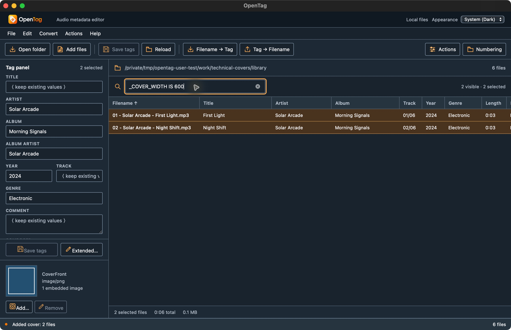
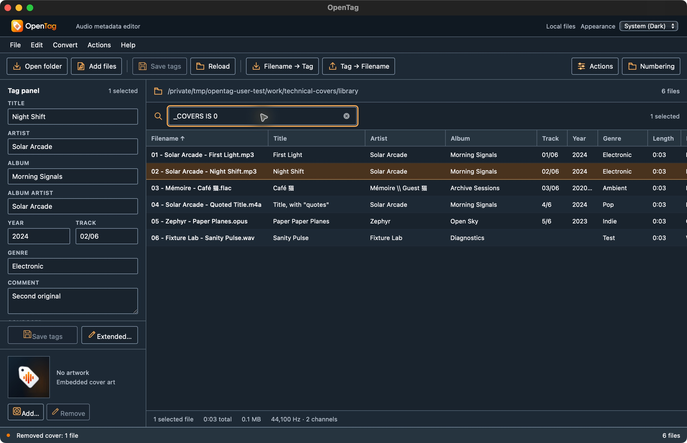

# Native technical-property and cover workflow checkpoint

On 2026-10-14, the actual macOS arm64 native debug app exercised measured-property filters, cover addition/removal and cover-export actions on six disposable audio fixtures. The bounded workflows below passed. No user music was used. This records the operator's native run and independently checked receipt contents; this documentation task did not operate the GUI, rerun tests or rebuild the app.

[The compact receipt](technical-cover-workflows.json) records source-stage hashes, output identities, AX observations and SHA-256 identities for the external evidence. Raw receipts remain under `/tmp/opentag-user-test/receipts/technical-covers/`: `before.json`, `covers-added.json`, `filename-cover-export.json`, `covers-removed.json`, `assertions.json`, AX captures and screenshots. The temporary raw evidence is not bundled into this repository.

## Actual tested build

The bundle was `/tmp/opentag-user-test/bundles/desktop-unique/OpenTag.app`, identifier `org.opentag.editor.usertest.desktop`. The executable SHA-256 was:

```text
ea605ca210c821eb49e7720001877f775c6454a5159522b9e41c5b57ae149307
```

The native build receipt is `/tmp/opentag-user-test/receipts/native-build-parity-desktop-unique.json`. Its base commit is `b15635360ad0f48d6f1b3ceef376b1aa3eaef07a`; this commit alone does not identify the tested dirty source tree. The tracked patch SHA-256 is `3e8875218c3a488f829093f74f32e731a645a4671ff1cb30992ce9adaed7f9d6`, and the archived untracked source SHA-256 is `49a25407ac26045b36b6d4288ffdb39b32bfe4ee4fdebf5e978f1a59d00e99db`. These archive identities are transcribed from that build receipt; the compact receipt includes its own hash.

## Measured properties reach the native filter

The library contained two MP3s and one each of FLAC, M4A/AAC, Opus and PCM WAV. Adding the same 600×600 PNG to the two selected MP3s produced one embedded cover in each. The native table and retained AX captures showed:

| Filter | Actual matching rows | Retained evidence |
| --- | --- | --- |
| `_CODEC IS AAC` | One M4A: Quoted Title | `measured-codec-filter-ax.txt` |
| `_COVER_WIDTH IS 600` | Two MP3s: First Light and Night Shift | `measured-cover-filter-ax.txt` and screenshot below |
| `_COVERS IS 1` before removal | Both MP3s | `export-distinct-filenames-ax.txt` |
| `_COVERS IS 1` after removing First Light's cover | Night Shift only | `cover-removed-one-ax.txt` |
| `_COVERS IS 1` after removing Night Shift's cover | No matching files | `cover-removed-all-ax.txt` |
| `_COVER_WIDTH IS 600` after both removals | No matching files | `cover-width-refreshed-ax.txt` |
| `_COVERS IS 0` after both removals | All six audio rows | `cover-zero-filter-ax.txt` and screenshot below |

The operator also visibly observed exactly the FLAC and WAV rows with `_BITSPERSAMPLE IS 16`. No separate AX capture or screenshot was retained for that step; it is an operator observation, not independently retained UI evidence. The final zero-cover filter is established by the six actual table rows. The UI omits the separate visible-count text when every loaded row matches, so that missing count label is not interpreted as zero matches.





## Export identity and source preservation

The cover-export action exported the identical PNG under two distinct evaluated title filenames: `outputs/First Light.png` and `outputs/Night Shift.png`. Both outputs were 2,411 bytes with SHA-256 `474b5eebee61cae290e3ea03d32b80de333ced94c1ec69e69adc6ada45613f92`, matching the embedded picture packet. Repeating with a shared base destination and duplicate export disabled produced one `outputs/shared.png` with the same identity. This exercises the bounded filename-plus-content duplicate contract through the native action workflow.

Comparing the **cover-added** receipt with the **filename-cover-export** receipt establishes that export changed none of the six complete source-file hashes. Comparing the pristine baseline directly with the export receipt would conflate export with the preceding intentional cover additions. The final receipt also records the shared-base output; the operator's assertions record its single-output result.

Across all four recorded stages, all six encoded-audio packet lists and decoded signed-16-bit PCM hashes matched baseline. All six ffprobe format-level tag dictionaries were unchanged. Only the two selected MP3 complete-file hashes changed during cover addition/removal; the four unselected complete files stayed byte-identical throughout. Both MP3s ended with zero covers, although their final complete-file hashes differed from pristine baseline. These checks establish the recorded packet/PCM/tag-dictionary invariants; they do not independently prove preservation of every opaque metadata structure.

## Qualification boundary

This is a native macOS source/debug-build UI checkpoint. It does not qualify the public release binary, original Mp3tag runtime equivalence, Windows/Linux UI, Android/iOS or document-provider save-back. Cover mutation was exercised only on the two MP3 fixtures. Other cover formats/options, duplicate-enabled cross-file collision behavior, every technical placeholder and complete tag-format preservation remain open. [The technical ledger](../CRITICAL-TECHNICAL.md), [action ledger](../CRITICAL-ACTIONS.md) and [parity ledger](../PARITY.md) retain those wider obligations.
