# Native workflow execution checkpoint

On 2026-10-14, native CUA operated the macOS arm64 debug app against six
independently generated three-second audio files under `/tmp/opentag-user-test`.
No user music files were selected or modified. The application identifier alone
was overridden to `org.opentag.editor.usertest`; the executable/source identities
are recorded in `user-workflows-results.json`. This is functional source testing,
not a byte-identical public release package or an original-Mp3tag differential.

## Discovery: partially verified

The actual Open folder picker recursively loaded six files: two MP3, FLAC, M4A,
Opus and WAV, including Unicode filenames and actual FLAC multivalues. Adding
both already-loaded MP3s through Add files kept six unique rows. Cancelling a
subsequent picker preserved the list. Independent complete-file SHA-256,
encoded-packet hashes and decoded PCM hashes remained unchanged for all six.

The plan's initial two-file load, both sort directions, all-row selection and
individual sample-rate/channel inspection remain unexecuted. UAT-01 is PARTIAL.

The native Go to Folder sheet did not accept automated Return/Escape input
reliably. The test used the picker's visible sidebar, location menu, folder list
and Open buttons instead. This automation limitation is not recorded as an app
failure or as a passed keyboard-navigation test.

## Common editing: passed after a reproduced fix

In a fresh common-case copy, the two MP3s showed their shared album and mixed
comments. Setting ALBUM to `UAT Shared Album` and COMMENT to
`UAT common — Café 猫` created two drafts. Before Save, all six complete-file
hashes and audio identities remained unchanged. Conversion/numbering/cover
operations showed pending-state restrictions.

The first actual Save reported two failures:
`The format could not preserve all values for field COMMENT`.
Both originals, all unselected files, and all audio remained unchanged. Raw ID3
inspection independently identified FFmpeg's `TXXX:comment` frame. The reader
exposes it as the same case-insensitive logical field as `COMM`; the writer
previously retained the old alias while inserting the standard frame.

The focused fix removes a matching logical-name UserText alias when replacing
its standard mapped field. Other fields remain untouched. A real ID3-tagged WAV
regression first failed with the native error, then passed replacement, Unicode,
unedited title-alias preservation, subsequent title replacement, comment removal,
unmanaged-field preservation and exact audio-byte checks. This does not establish
universal support for every alternate alias or MOVEMENT representation.

After rebuilding and reopening the unchanged common fixtures, the same two
drafts saved successfully: `Saved tags: 2 files`. Reload returned the exact album
and Unicode comment, with no pending edits or operation errors. Independent
ffprobe inspection confirmed both tag dictionaries equal their originals with
only the requested album/comment changes. Exactly the two selected MP3 file
hashes changed; the four unselected files stayed byte-for-byte identical. All six
encoded-packet hashes and decoded PCM hashes matched the baseline. UAT-02 PASS.


The regular app retained System (Dark) when the isolated app selected Light.
The regular profile's action configuration did not exist before testing; action
configuration persistence/isolation will be exercised with the group workflow.
The isolated app retained Light across actual native Quit/relaunch cycles.

Validation: 15 metadata integration tests and 13 mapping integration tests passed,
including the generated encoded-format/audio-packet matrix. Core all-target
Clippy passed with warnings denied. The isolated native debug bundle built and
signed ad-hoc successfully. These results do not certify mobile file access.

## Native filters: passed with recorded dataset variation

The visible Filter control exercised Boolean AND/NOT, scripted `$upper` values,
Boost lookbehind and pattern backreferences, malformed Boolean syntax, an invalid
regular expression, and a quick valid → invalid → clear sequence. Final clearing
restored all six rows and retained the two selected files. Every expected result
was observed; see `user-workflow-filter-results.json`. The invalid regex reported
its actual unmatched-parenthesis error instead of silently returning no matches.

This case reused the successfully saved common dataset. Unicode search `猫`
therefore correctly matched the two MP3 comments as well as the FLAC (three
files); the other plan queries were unaffected by the earlier album/comment
edits. All six complete-file hashes stayed unchanged throughout filtering.
Native AX typing substituted a curly quote in the short invalid-regex input;
pasting the literal expression through the visible control verified the actual
Boost error. General typing substitutions remain a separate UX investigation.
UAT-07 PASS with this explicit input variation.

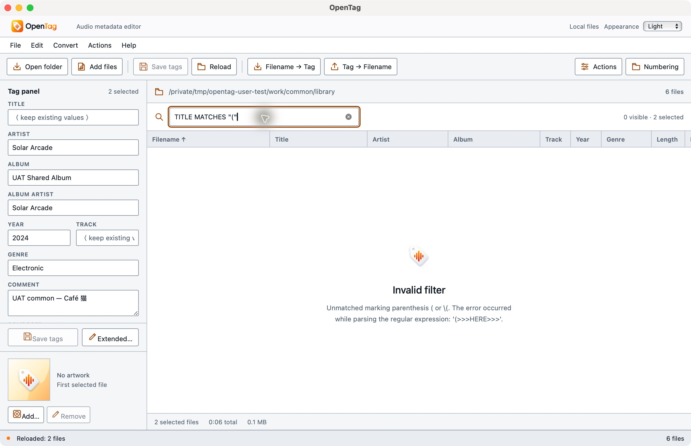

## Extended tags: passed after a reproduced mixed-format fix

UAT-03 used an independent six-file copy. Native Extended tags displayed two
ARTIST and two MOOD values as separate controls. Added a third MOOD value,
created a two-line COMMENT, removed UAT_REMOVE, and swapped TEST_A/TEST_B names
without replacing their values. Keep changes left every file byte-identical.
Save/Reload then retained the exact three MOOD values, two ARTIST values, line
break, swapped values and deletion. Only the FLAC file changed; all six encoded
and decoded audio identities remained identical.

Selecting that FLAC with an MP3 and renaming MOOD initially failed with
`Duplicate field: ALBUM`. The dialog had separate rows for native `ALBUM` and
`album`, then uppercased both during validation. A separate test also exposed
that case-only differences in source keys could lose values during a rename.

The fix builds one row per ASCII-insensitive logical name and indexes each
file's actual spelling and original values. Two-pass resolution retains swaps,
per-file multivalues and untouched raw names. DATE/YEAR remain distinct, as do
custom names such as maß/MASS. Three focused regressions passed with the rest
of the 35 JavaScript tests. The native debug bundle rebuilt successfully.

The rebuilt dialog displayed one ALBUM row and opened at the first field;
previously initial Add field focus had scrolled it to the bottom. Renaming MOOD
to UAT_MOOD in the mixed selection created and saved exactly one FLAC draft.
The MP3 acquired no field or physical write. Reload retained all three values
under UAT_MOOD. Independent raw Vorbis inspection confirmed ARTIST, COMMENT,
TEST_A/TEST_B and every unrelated key/value, including native casing, stayed
intact. All five other complete files stayed unchanged; all six encoded-packet
and PCM hashes matched the original fixture baseline. UAT-03 PASS.

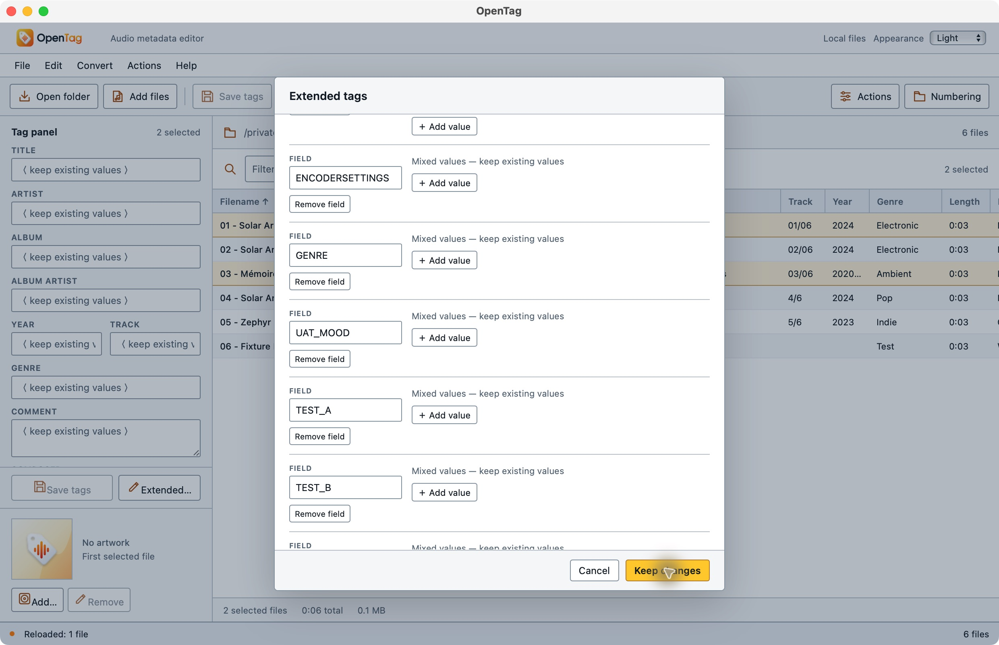

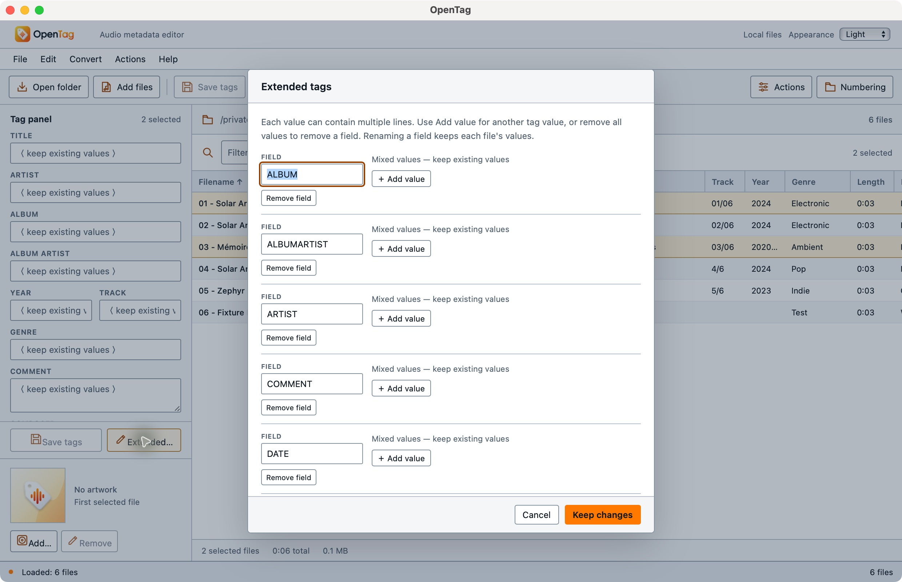

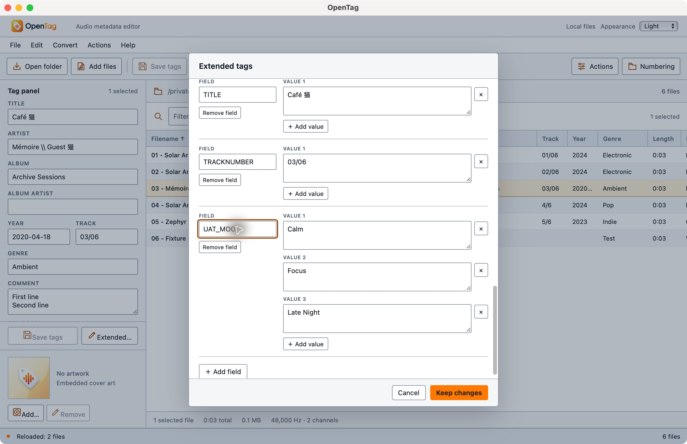

The metadata reader and writer do not yet use identical Unicode field-name
identity rules in every path; this checkpoint does not claim universal Unicode
custom-field equivalence. The focused reviewer found no introduced loss or swap
defect in these changes.

## Numbering: passed

UAT-04 used a fresh case. Clicking the visible Filename header switched the
table to descending order. The selected Night Shift/First Light files received
07/2 and 08/2 from start 7, two digits and total tracks enabled. Applying numbers left
all complete-file hashes unchanged until Save. Save and Reload persisted the
exact strings in visible order; independent ffprobe dictionaries differed only
in TRACK. Four unselected files and all six audio payloads were unchanged.
Cancelling another numbering dialog created no draft. UAT-04 PASS. This covers
the implemented basic numbering interface, not the missing disc-reset wizard.

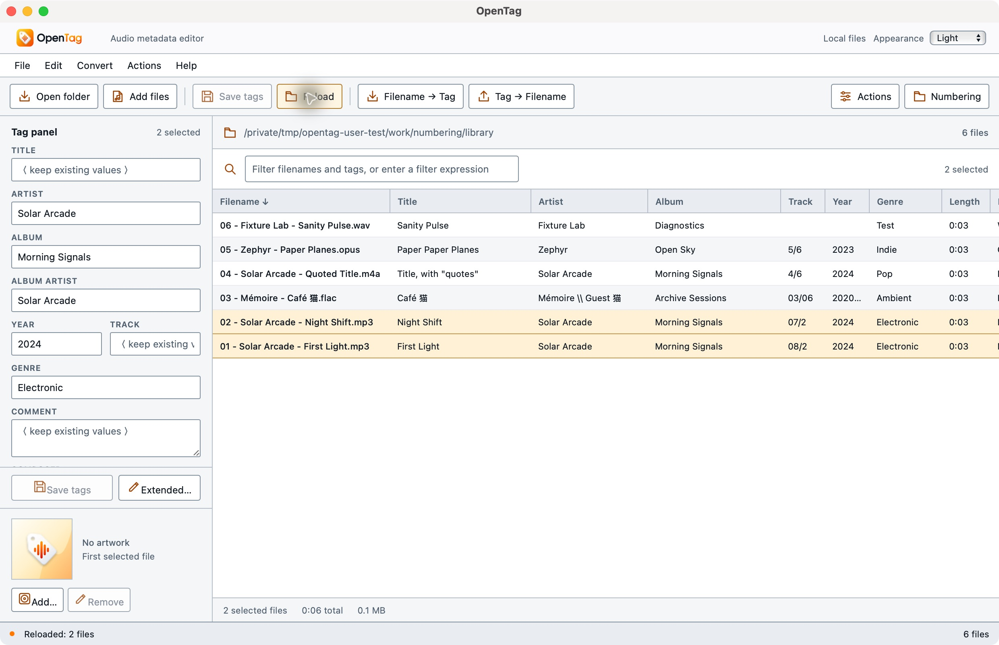

## Filename conversion: passed

UAT-05 saved Needs import as the two MP3 titles, then previewed
`%track% - %artist% - %title%`. The visible preview extracted artist Solar Arcade,
original titles and tracks 01/02 without extensions. Independent before/after
preview hashes proved all six files unchanged. Apply and Reload restored the
titles and wrote the extracted tracks. Independent probes confirmed every other
tag, all unselected complete files and all audio remained intact. The pattern
`NO MATCH %title%` produced an explicit error with Apply disabled. UAT-05 PASS.

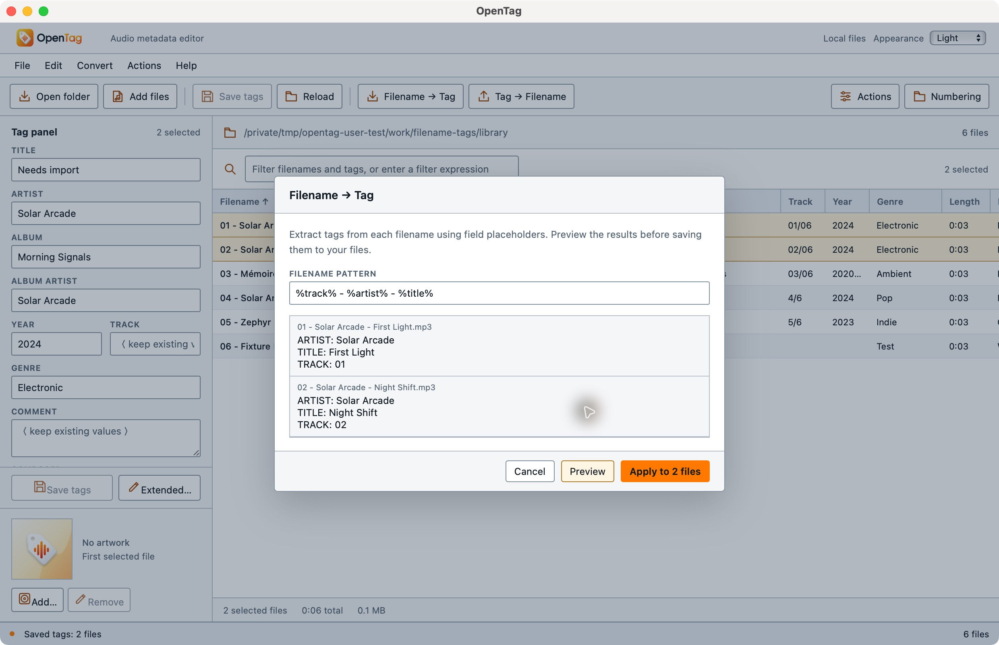

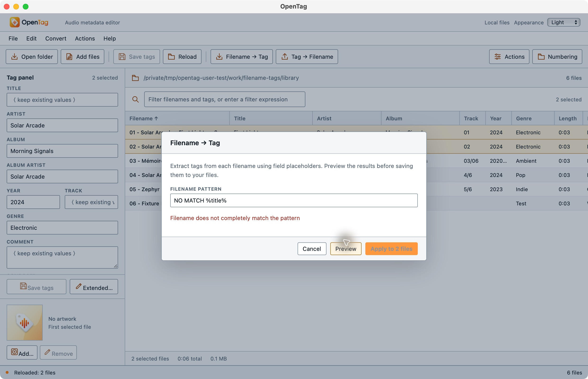

## Reviewed dynamic and counter renaming: passed

UAT-06 used separate fresh dynamic and counter copies. Previewing UAT-$uuid(),
then changing to UAT2-$uuid(), disabled Apply until a new preview. Apply created
exactly the final visible UUID destination, retained the extension, removed the
old source, and reconciled the selected row. Reload succeeded. The first preview
path was never created. A later preview was cancelled without another file.

The two-file counter pattern `$num(%_counter%,2) - $upper(%title%)` in ascending
Filename order previewed and applied exactly 01 - FIRST LIGHT.mp3 and
02 - NIGHT SHIFT.mp3. Independent receipts confirmed previews changed no bytes,
and all six complete-file contents and encoded/decoded audio remained identical
after each rename case. Exact reviewed destinations are in the results JSON.
UAT-06 PASS.

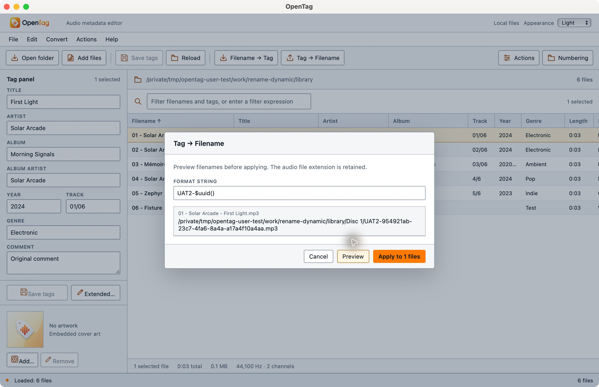

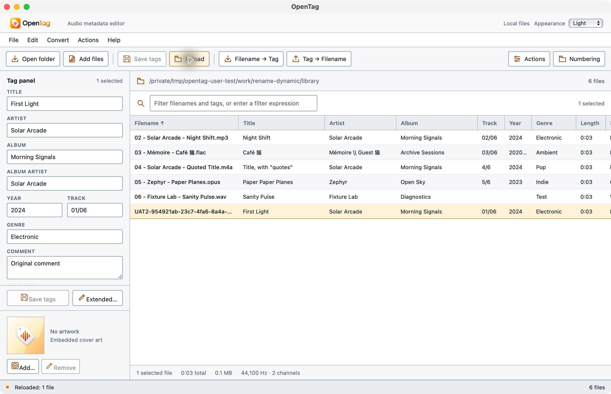

## Quick regular-expression action: passed

UAT-08 selected First Light and applied Replace with Regular Expression to TITLE,
using lookbehind `(?<=First )Light` and replacement Glow. The dialog explicitly
stated immediate saving; First Glow persisted after Reload with no separate Save.
Option+Shift+6 opened Quick Actions on macOS. Applying invalid pattern `(` showed
the actual unmatched-parenthesis error. Cancelling it and another quick dialog
left all six complete-file hashes equal to their before-error checkpoint.
Independent ffprobe tags differed from the original only in the selected title;
the other five files and all audio remained unchanged. UAT-08 PASS.

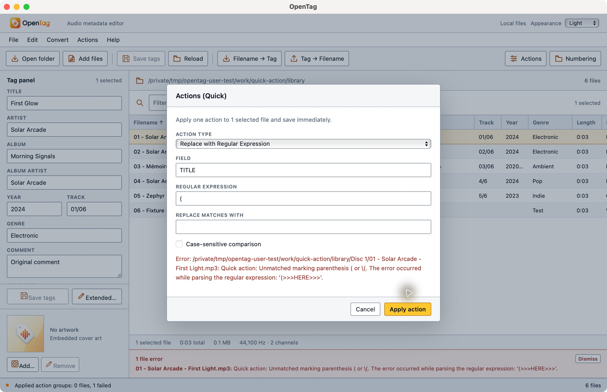

## Ordered action groups and saved selection preset: passed

UAT-09 used a fresh six-file groups copy and the same isolated native build
recorded for UAT-03. Imported UAT-A-uppercase-comment and UAT-B-prefix-comment,
then placed an Export action before A's Format Value COMMENT action. Both groups
were saved and enabled in A→B order. Native Quit/relaunch retained that order,
the two actions in A, the one action in B, and the saved selection preset
`UAT ordered A then B`. Unchecking B and choosing the preset restored both
checkboxes without changing either group's action contents. The regular
profile's `actions.json` remained absent.

All six complete-file hashes were unchanged before Apply. Applying to the two
MP3s created `/private/tmp/opentag-user-test/work/groups/outputs/group-a.txt`:

```text
01 - Solar Arcade - First Light.mp3|FIRST LIGHT
02 - Solar Arcade - Night Shift.mp3|NIGHT SHIFT
```

The output SHA-256 is
`cdfb8c0f6708955c5204f9570ffaad555d9749a6fc80afdd286747db0e576755`.
It contains A's uppercase comments despite Export preceding Format Value in the
list, and contains neither the original comments nor B's later prefix. Final
saved comments were `B:FIRST LIGHT` and `B:NIGHT SHIFT`. This verifies deferred
export at A's group boundary. Only those two MP3 comment tags changed; the other
four complete files and all six encoded-audio/decoded-PCM identities were
preserved. UAT-09 PASS. The optional fresh-media reversed-order run and unresolved
`.mta` import remain NOT RUN.

Receipts: `/tmp/opentag-user-test/receipts/groups/{before,before-apply,applied,assertions}.json`.
The source screenshots also record the action order, restart, B unchecked,
preset restoration and reloaded saved comment. Exact paths/build identity are in
the results JSON; this is the recorded extended-fix functional build, not a new
public release qualification.

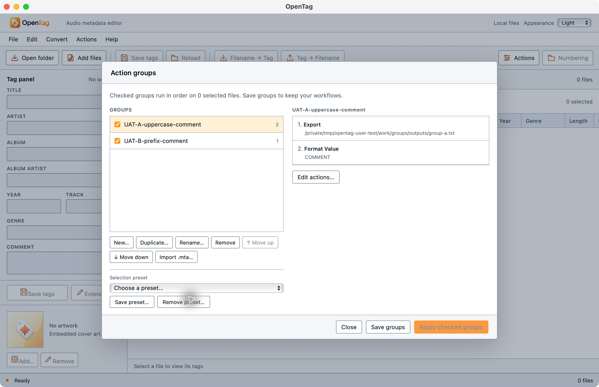

## Cover addition, properties and selective removal: passed

UAT-10 used a separate fresh six-file copy. Added the PNG to First Light and
Reloaded. Quick Set Cover Properties changed it to Back Cover with description
`UAT back — 猫`, with keep-existing-description disabled. Added the JPEG as a
second selectable cover, selected that JPEG and Removed it, then Reloaded. The
PNG retained its exact bytes, back-cover type and Unicode description. Removing
the final PNG and Reloading showed No artwork; independent probes confirmed zero
remaining picture packets. UAT-10 PASS.

Independent receipts measured the PNG at 600×600/2,411 encoded bytes and JPEG at
800×450/8,002 encoded bytes. Their embedded packet hashes matched their input
files exactly, including the retained PNG after the JPEG removal. The panel
shows MIME, type (`CoverBack`) and description; dimensions are not visible in
this build and were verified only by the independent probes.

At every checkpoint, all original tag dictionaries remained unchanged, the five
unselected complete files stayed byte-identical, and all six encoded-audio and
decoded-PCM identities matched baseline. This does not require the selected
file's final padding/layout to equal its original complete-file bytes.

Receipts: `/tmp/opentag-user-test/receipts/covers/{before,png-added,properties,two-covers,jpeg-removed,all-removed,assertions}.json`.
Source screenshots cover each mutation and the final empty-artwork state.

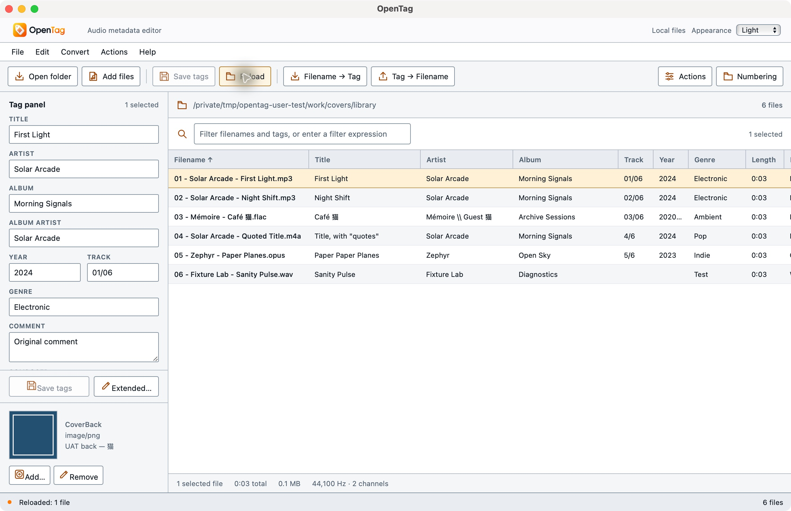

## Fixed CSV and M3U8 export: passed after a reproduced fix

UAT-11 selected First Light, the multivalue FLAC and the quoted-title M4A in
ascending Filename order, using the same extended-fix native build as UAT-03.
The real save dialogs created UTF-8 CSV and M3U8 files with three selected
records. The CSV had the eight expected columns and correctly quoted the M4A
title as one cell. Playlist paths retained Unicode and the selected order.

The outputs nevertheless omitted existing tag values. The FLAC CSV record had
an empty TITLE, ALBUM, TRACK, YEAR and GENRE despite those values being present
in the independently probed file; the MP3 COMMENT was also empty. The playlist
contained `#EXTINF:3,Mémoire / Guest 猫 - ` with no FLAC title. Export lookups did
not account for the actual native field spellings. This first native run failed;
its output rows and hashes remain in the results JSON.

The initial CSV SHA-256 was
`ccbade50bfd663505c39d90fb3469064b73d1d439e13f332fdf279819e170f94`;
the initial M3U8 SHA-256 was
`7d27b5f7923b2c34c8d481b49662af4526918db409a1b5a81524b8887f90cd1e`.
All six complete audio-file hashes and encoded/decoded payloads remained
unchanged. A focused native fix uses case-insensitive lookups and explicit
Vorbis TRACKNUMBER/DATE fallback for the fixed TRACK/YEAR columns. Two native
regressions were added; the 22-test native suite and strict clippy passed before
the isolated app was rebuilt.

Receipts: `/tmp/opentag-user-test/receipts/exports/{before,exported,exported-comparison}.json`.
Initial output rows/text and their hashes are retained in the results JSON.

The actual rebuilt replay used fresh `exports-fixed` media and source commit
`cfd2bd7b6394105c872a83ba22927f3752934702`, executable SHA-256
`bce38f3922169b8650913d82f4934465f3cfb8d0f29545af364093c9ebc1ffb0`.
The native build receipt records the identifier-only profile override and
functional source hashes; only proof documentation/screenshots were dirty.
The same three-file selection produced all expected CSV values, including
FLAC TITLE `Café 猫`, both artists, ALBUM `Archive Sessions`, TRACK `03/06`,
YEAR `2020-04-18`, GENRE `Ambient`, and MP3 COMMENT `Original comment`.
The comma/quote-containing M4A title parsed as one exact cell.

M3U8 contained the correct artist/title strings in the same selected order,
including the previously missing FLAC title. Each relative media path resolved
to its actual selected file. Cancelling another CSV picker left exactly the two
expected outputs. All six complete files and encoded/decoded payloads remained
unchanged. **UAT-11 PASS after the native replay**; the optional overwrite
attempt remains NOT RUN.

The corrected CSV SHA-256 is
`5ccd4b58454ade8fff6d18e46c6682fdfef4fc2e2f79bd693ceb5be82c3b0558`;
the corrected M3U8 SHA-256 is
`69d4a42b442660c7a77f85b0c07718c5ba698ceb62bd034e20404739e38cf926`.
Receipts: `/tmp/opentag-user-test/receipts/exports-fixed/{before,exported,assertions}.json`,
with native screenshot/AX and `native-build-export-fix.json`. The results JSON
keeps the failing and corrected attempts under their separate build identities.

## Unsaved window close and action-group changes: passed

UAT-12 used the same isolated extended-fix functional build, executable SHA-256
`b4489f5b2ae3bfff13e73241b5f0034dcbccc9d5206e78f4ea60baf1dfffc296`.
A TITLE draft `Never write this` triggered the native close alert:
`Close OpenTag and discard pending changes in 1 file?`. Choosing No retained
the window, selection and pending value. Choosing Yes on a second close
discarded the draft. A fresh launch and library load showed original TITLE
`First Light` with no pending tag edits.

Creating `UAT never save this group` without saving then closing triggered
`Close OpenTag and discard unsaved action group changes?`. No retained the
unsaved group; Yes discarded it and closed the app. After another actual
relaunch, the unsaved group was absent and the saved A/B groups remained.
Independent cancelled/discarded receipts proved all six complete files and all
encoded-packet/decoded-PCM identities unchanged. UAT-12 PASS.

Receipts: `/tmp/opentag-user-test/receipts/unsaved-close/{before,cancelled,discarded}.json`.
Native AX records include both alert texts, the clean reloaded title, and the
reopened action dialog. This is window-close coverage; it does not establish
force-quit/crash recovery or every platform's quit behavior.


## Appearance preserves active selection, filtering and drafts: passed

UAT-13 used a fresh appearance-state copy and that same extended-fix executable.
Filename was descending, both MP3s selected, and `_EXTENSION IS mp3` retained
two visible rows. COMMENT `Theme must preserve this` remained pending for both
files. Switching Dark and Light preserved the two selected files, descending
order, filter, pending value and two-file dirty count.

The actual Extended dialog displayed the pending comment in each mode and was
cancelled. The invalid filter `ARTIST IS "Solar Arcade" AND (` displayed
`Missing filter operand` in both modes while the drafts remained intact.
Native screenshots cover the working state, dialogs and error in each mode.
An explicit Edit → Discard confirmation then cleared the drafts; independent
receipts showed all six complete files and encoded/decoded audio unchanged.

After a native Quit/relaunch, explicit Light persisted. Selecting System
displayed `System (Dark)`, matching the read-only OS observation
`AppleInterfaceStyle: Dark`. No system setting was changed. UAT-13 PASS within
that scope; **live OS appearance-change propagation remains NOT RUN**.

Receipts: `/tmp/opentag-user-test/receipts/appearance-state/{before,after-theme-discard}.json`.
`dark-ax.txt`, `light-ax.txt`, `restarted-light-ax.txt`, `system-dark-ax.txt`,
`os-appearance.txt` and the corresponding native screenshots retain the
individual observations. This working-data test is distinct from earlier
branding-only appearance checks.

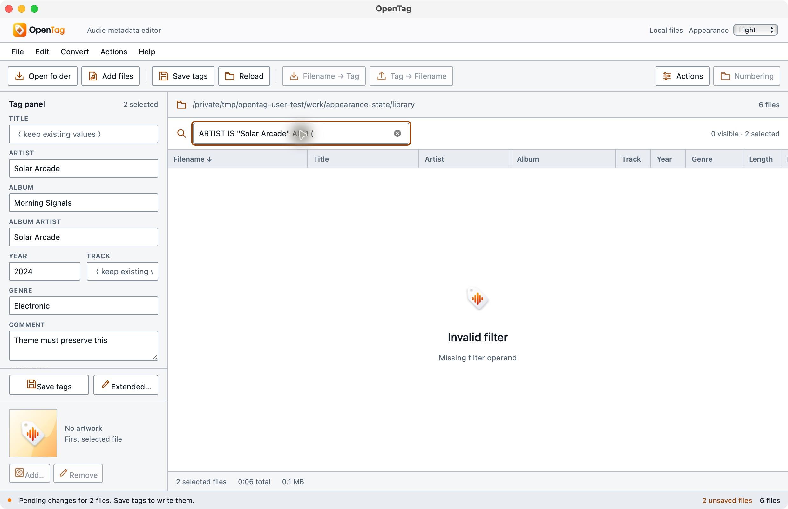

## Multiline Unicode text-import action: passed

UAT-14 used Quick Actions → Import Text File, FIELD LYRICS, and the absolute
fixture path `/tmp/opentag-user-test/fixtures/text/lyrics-utf8.txt`. It wrote
immediately. After Reload, Extended tags displayed both Unicode lines. The
independent ffprobe value was exactly
`UAT first line — Café 猫\nUAT second line\n`, including its trailing newline.
The selected file's dictionary changed only by this LYRICS addition, the five
unselected complete files stayed identical, and all six encoded-packet and
decoded-PCM identities matched baseline. UAT-14 PASS for this Quick action.

Receipts: `/tmp/opentag-user-test/receipts/text-action/{before,imported-reloaded,assertions}.json`,
plus `extended-ax.txt` and the native screenshot below. The **standalone
positional Text File → Tag converter UI is NOT PRESENT in this build**. The
successful Import Text File action must not be reported as that separate
converter's UI qualification.

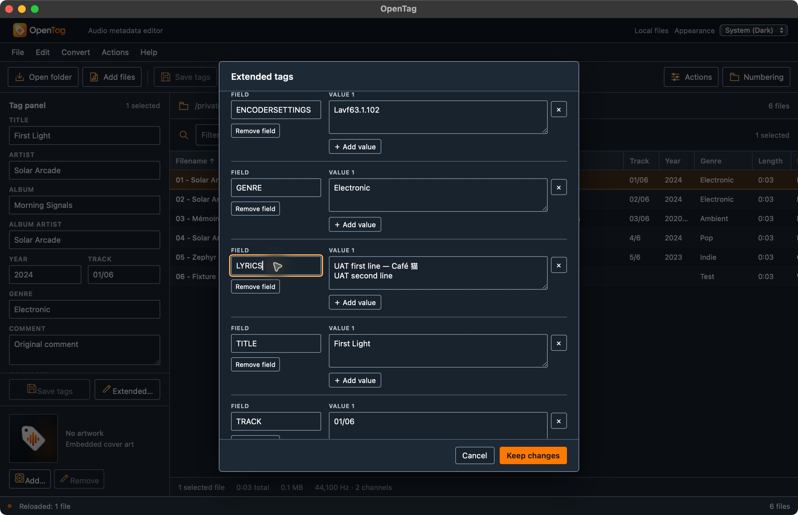

UAT-01 remains PARTIAL; UAT-02 through UAT-14 pass within their stated scopes. The
optional reversed-group/unresolved-import branches, live OS-change propagation
and optional export overwrite attempt remain NOT RUN. Original
format/preferences/converter/action parity remains open in the project ledger
and documentation inventory. These native debug source tests do not qualify a
byte-identical public release package or mobile document editing/save-back.
