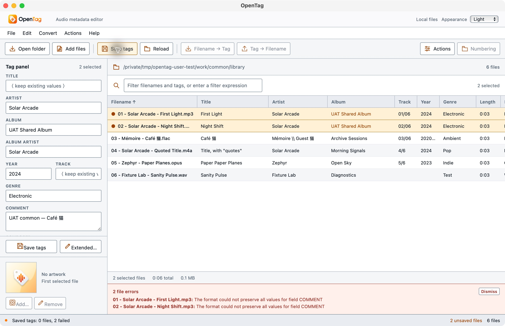
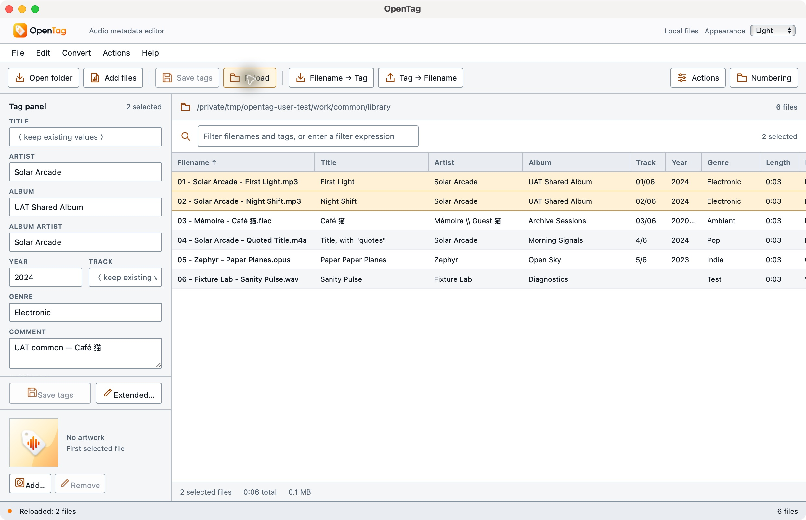

# Native workflow execution checkpoint

On 2026-10-14, native CUA operated the macOS arm64 debug app against six
independently generated three-second audio files under `/tmp/opentag-user-test`.
No user music files were selected or modified. The application identifier alone
was overridden to `org.opentag.editor.usertest`; the executable/source identities
are recorded in `user-workflows-results.json`. This is functional source testing,
not a byte-identical public release package or an original-Mp3tag differential.

## Discovery: partially verified

The actual Open folder picker recursively loaded six files: two MP3, FLAC, M4A,
Opus and WAV, including Unicode filenames and actual FLAC multivalues. Adding
both already-loaded MP3s through Add files kept six unique rows. Cancelling a
subsequent picker preserved the list. Independent complete-file SHA-256,
encoded-packet hashes and decoded PCM hashes remained unchanged for all six.

The plan's initial two-file load, both sort directions, all-row selection and
individual sample-rate/channel inspection remain unexecuted. UAT-01 is PARTIAL.

The native Go to Folder sheet did not accept automated Return/Escape input
reliably. The test used the picker's visible sidebar, location menu, folder list
and Open buttons instead. This automation limitation is not recorded as an app
failure or as a passed keyboard-navigation test.

## Common editing: passed after a reproduced fix

In a fresh common-case copy, the two MP3s showed their shared album and mixed
comments. Setting ALBUM to `UAT Shared Album` and COMMENT to
`UAT common — Café 猫` created two drafts. Before Save, all six complete-file
hashes and audio identities remained unchanged. Conversion/numbering/cover
operations showed pending-state restrictions.

The first actual Save reported two failures:
`The format could not preserve all values for field COMMENT`.
Both originals, all unselected files, and all audio remained unchanged. Raw ID3
inspection independently identified FFmpeg's `TXXX:comment` frame. The reader
exposes it as the same case-insensitive logical field as `COMM`; the writer
previously retained the old alias while inserting the standard frame.

The focused fix removes a matching logical-name UserText alias when replacing
its standard mapped field. Other fields remain untouched. A real ID3-tagged WAV
regression first failed with the native error, then passed replacement, Unicode,
unedited title-alias preservation, subsequent title replacement, comment removal,
unmanaged-field preservation and exact audio-byte checks. This does not establish
universal support for every alternate alias or MOVEMENT representation.

After rebuilding and reopening the unchanged common fixtures, the same two
drafts saved successfully: `Saved tags: 2 files`. Reload returned the exact album
and Unicode comment, with no pending edits or operation errors. Independent
ffprobe inspection confirmed both tag dictionaries equal their originals with
only the requested album/comment changes. Exactly the two selected MP3 file
hashes changed; the four unselected files stayed byte-for-byte identical. All six
encoded-packet hashes and decoded PCM hashes matched the baseline. UAT-02 PASS.

The regular app retained System (Dark) when the isolated app selected Light.
The regular profile's action configuration did not exist before testing; action
configuration persistence/isolation will be exercised with the group workflow.
The isolated app retained Light across actual native Quit/relaunch cycles.

Validation: 15 metadata integration tests and 13 mapping integration tests passed,
including the generated encoded-format/audio-packet matrix. Core all-target
Clippy passed with warnings denied. The isolated native debug bundle built and
signed ad-hoc successfully. These results do not certify mobile file access.

UAT-03 through UAT-14 remain NOT RUN in this workflow suite. Earlier appearance
and menu checks are separately recorded in `branding-appearance.md` and
`menu-switch.md`; they are not substitutes for the remaining working-data cases.
Original format/preferences/converter/action parity remains open in the project
ledger and documentation inventory.
